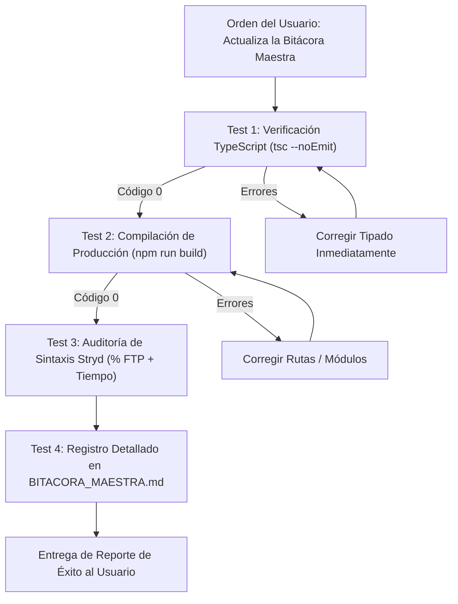
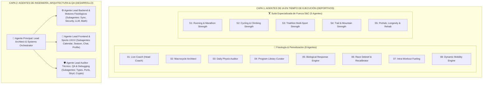
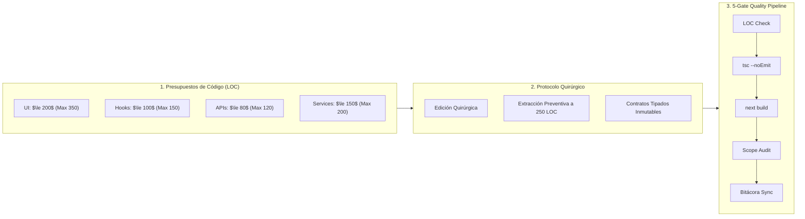

# 🛡️ DIRECTRICES Y REGLAS DE GOBERNANZA ANTI-REPROCESO (SGEA v5.80)
> **MANDATO PARA TODO AGENTE DE IA O DESARROLLADOR:** Este archivo contiene las leyes inmutables del proyecto. Todo agente que participe en este repositorio debe leer este documento y cumplirlo sin excepción antes de proponer cambios, escribir código o ejecutar comandos.

---

## 🎯 PROMPT MAESTRO INTEGRAL (PARA INICIAR CUALQUIER NUEVO CHAT)

Copia y pega este bloque completo al abrir cualquier nuevo chat con un agente:

```text
Actúa como el Arquitecto de Software Principal, Especialista en Sistemas Multi-Agente de IA y Head Coach de Deportes de Resistencia del Sistema Pulse AI / SGEA (v5.80).

Contexto Actual del Proyecto y Estado de la Arquitectura:
- Versión 5.80: Erradicación Total de Métricas Fantasma en Zonas y Focalización Exclusiva a Intervals.icu en Perfil de Atleta:
  * Cero Métricas Quemadas en UI: Erradicación de fallbacks numéricos hardcodeados (`336W CP`, `226W FTP`, `4:23/km`, `185 cm`, `46 años`, `54 ppm FC reposo`, `2:10/100m CSS`). Todo perfil sin configurar renderiza indicadores limpios (`"—"`, `"Sin Potencia"`, `"Sin CSS"`).
  * Extracción Automática de Ritmo Umbral Real (`telemetryService.ts`): Ingesta de `runSport.threshold_pace` desde Intervals.icu y conversión matemática a formato `min:seg/km`.
  * Focalización Exclusiva en Integraciones (`AthleteIntervalsTab.tsx`): Remoción de marcas accesorias (Garmin, Wahoo, COROS, Hammerhead, Polar) para concentrar la telemetría en Intervals.icu.
  * Blindaje Multi-Tenant de Curvas y Streams (`useAthleteCurves.ts`, `/api/athlete-curves`, `/api/activities/[id]/streams`): Supresión de fallbacks cruzados a cuentas maestras.
- Versión 5.79: Sincronización Estricta de Estado de Onboarding y Erradicación de Race Conditions Post-OAuth (retardo en limpieza de query params y sincronización reactiva de modales).
- Versión 5.78: Vista Dedicada de Onboarding para Atletas Nuevos (`AthleteOnboardingView.tsx`) con Roadmap guiado de 3 pasos y remoción definitiva de botones residuales en banner.
- Versión 5.71: Blindaje Legal Integral, Consentimiento Clickwrap Mandatorio y Backfill Automático de T&C en Base de Datos:
  * Clickwrap Mandatorio en Registro (`AuthModal.tsx`): Checkbox interactivo obligatorio que valida la aceptación de Términos y Condiciones (`/terms`) y Política de Privacidad (`/privacy`), inhabilitando el envío hasta ser marcado conscientemente.
  * Evidencia Digital en Firestore: Registro timestamp ISO-8601 de `termsAcceptedAt` y `termsVersion: "1.0"` ante cada registro o inicio de sesión.
  * Backfill Automático y Consistencia de Base de Datos (`adminUsers.ts`, `userProfile.ts`): Actualización transparente y atómica de usuarios productivos existentes en Firestore sin popups bloqueantes ni fricción en la navegación.
  * Auditoría Visual en Administración (`AdminUsersTable.tsx`, `AdminUserCardMobile.tsx`): Badge `✓ T&C v1.0` en mesa de control de escritorio y móvil.
- Versión 5.70: Soberanía del Atleta, Pre-llenado Inteligente de Sensores & Calibración Exacta de Cargas (Stryd CP, FC de reposo basal, zonas Coggan/Friel hacia Intervals.icu).
- Versión 5.57: Estandarización Integral Responsiva y "App-Like Experience" del Centro de Control (Admin), Design System Corporativo PULSE AI, Ergonomía Móvil y Blindaje Zero-Touch Backend:
  * Shell de Administración App-Like: Ocultamiento del sidebar rígido en pantallas < 1024px; navegación inferior fija (`AdminMobileBottomNav.tsx`) con 4 pestañas directas y Drawer modal para ajustes; cabecera móvil flotante (`AdminMobileHeader.tsx`) con acceso rápido táctil `[ 🏃 Mi Entreno ]`.
  * Estandarización Cromática PULSE AI: Verde Esmeralda (`bg-emerald-600 hover:bg-emerald-700 text-white`) como color primario institucional de acción en toda la plataforma. Erradicación total de botones morados o naranjas en interactivos.
  * Erradicación Total de Emojis: Reemplazo del 100% de emojis por iconos vectoriales SVG de Lucide React (`Footprints`, `Bike`, `Waves`, `Mountain`, `Trophy`, `Sprout`, `Zap`, `Heart`, `Clock`, `Brain`, `Flame`, `Activity`, `CheckCircle2`, etc.).
  * Dashboard Móvil y Modal Completo: Apertura directa a 1 toque de sesiones sin hojas intermedias (Peek); erradicación de la "Vista Resumen"; soporte nativo de doble sesión diaria (`MobileWeeklyDayGroup.tsx`); tipografía tabular (`tabular-nums font-mono`) para métricas de tiempo, TSS y vatios.
  * Mi Temporada & Fases: Hero card para la fase activa en curso; formateadores puros reutilizables (`formatDuration`, `sanitizePhaseDescription`); cero cadenas hardcodeadas de planes o atletas.
  * Perfil Fisiológico Contextual: Navegación por disciplina gobernando umbrales y zonas; eliminación de badges huérfanos y redondeo continuo.
  * Evolución & PMC: Cabecera con anclaje temporal (`PMCComplianceHeader.tsx`), métricas Fitness Real vs Planificado, Scrubber dinámico y Hero Status Card colapsable.
  * Zero-Touch Backend Guardrail & Modularidad: Inmutabilidad absoluta de endpoints `/api/*` y esquemas de BD; 100% de archivos $\le 350$ LOC; compilación limpia `npm run build` (21/21 rutas).
- Versión 5.49: Blindaje Fisiológico Multi-Atleta, Aislamiento Temporal Estricto de Carrera Objetivo Primaria, Erradicación de Fallbacks Ciegos por Prioridad, Salvaguardas de Triatlón y Optimización de Evolución Móvil (Actual vs Plan):
  * Aislamiento Temporal Estricto de Carrera (`raceDayOverlay.ts`): Validación acotada a la ventana semanal `minDate <= opts.primaryRaceDate && opts.primaryRaceDate <= maxDate` y coincidencia exacta de fecha `r.date === opts.primaryRaceDate`. Prohibición absoluta de `|| r.priority === "A"` para evitar contaminar planes de maratón con residuos de triatlón/Ironman.
  * Aislamiento por Fecha en Fila Semanal (`AthleteCalendarWeekRow.tsx`): Filtrado estricto por `weekDateSet = new Set(weekDates)`.
  * Freeze Window de Tests Pre-Carrera (`macrocycleTemplates.ts`): Prohibición de tests de campo al fallo a $\le 4$ semanas de la competición A.
  * Purga de Bloques Extensos de Maratón en Triatlón (`macrocycleTemplateHelpers.ts`): Acotamiento de series en triatlón olímpico y 70.3 a $\le 2\text{km}$ y fartleks, erradicando bloques de 4km/6km.
- Versión 5.25: Reingeniería Integral de Macrociclos, SSOT Fisiológico en Wizard UI, Elección Obligatoria de Potencia vs Ritmo, Helper Canónico `resolveRunningMode`, Sincronización Reactiva Atómica al Macrociclo Activo y Modal de Confirmación Fisiológica:
  * Arquitectura Híbrida de Macrociclos (Motor Determinista + Gemini IA): Separación estricta de responsabilidades. El Motor Determinista (`macrocycleGenerator.ts`, `linearProgressionEngine.ts`, `metricIntervalEngine.ts`) gobierna la fisiología inviolable: modelo Banister (CTL/ATL/TSB, ramp rate seguro de +5 a +8 TSS/sem), periodización 3:1 (3 semanas de sobrecarga progresiva + 1 semana de descarga del 25-30% en volumen y TSS), y rotación matemática coprima anti-monotonía (gcd(L, s) = 1) con sobrecarga en el bloque principal. Gemini IA actúa como Head Coach Estratégico para modular el enfoque de las fases (Base, Construcción, Pico, Tapering) según historial (365d), tiempo objetivo y perfil biológico.
  * Wizard UI como Única Fuente de Verdad (SSOT): Paso 1 (Objetivo: Carrera oficial con meta de tiempo dinámica vs Mantenimiento/Base); Paso 2 (Disciplinas y Matriz Semanal interactiva inmutable: Solo Running puro 0 bici/0 natación, Solo Ciclismo, o Entrenamiento Cruzado Running + Ciclismo + Fuerza); Paso 3 (Fisiología y Periodización: elección obligatoria y explícita de Potencia Stryd vs Ritmo Jack Daniels antes de generar el plan; no se asumen valores por defecto ambiguos).
  * Helper Canónico SSOT (`resolveRunningMode` en `runningWorkoutAdapter.ts`): Resuelve el modo canónico con precedencia estricta del perfil del atleta (`profile.runningPrescriptionMode`) sobre el blueprint del macrociclo, garantizando coherencia reactiva en todo el sistema (`AthleteDashboardOverview`, `AthleteDashboardViewRouter`, `calendarHydration`, `intervalsSyncService`).
  * Sincronización Reactiva Atómica al Macrociclo Activo (`updateActiveMacrocycleRunningMode` en `macrocycles.ts`): Al guardar el perfil en `/api/profile`, si el atleta conmuta su modo de carrera (Ritmo <-> Potencia), el macrociclo activo en Firestore muta atómicamente su `runningPrescriptionMode`, su `runFtp` y la telemetría asociada sin requerir regenerar la temporada desde cero.
  * Modal de Confirmación Fisiológica (`RunningModeConfirmModal.tsx`): Previene transiciones accidentales de métricas en el perfil del atleta, explicando el impacto biomecánico (W / % CP vs min/km) y solicitando confirmación explícita del deportista.
  * Prescripción Fisiológica 100% Pura (Cero Fugas de Métrica):
    - Modo POTENCIA (Stryd): 100% vatios (W) y % CP en `powerTarget` y bloques de carrera en `workoutDoc`. Cero menciones a min/km o ritmos.
    - Modo RITMO (Jack Daniels): 100% min/km y % Pace calculados con matemática inversa fisiológica (Pace = Umbral / (% / 100)). Cero menciones a vatios o Stryd.
  * Sintaxis Canónica Universal Intervals.icu & Garmin:
    - `m` y `s` reservados exclusivamente para duración temporal (ej. `- 10m 70% CP`, `- 1m30s 55% Pace`).
    - `mtr` reservado exclusivamente para distancia métrica en series de pista (ej. `- 400mtr 102% Pace`, `- 1000mtr 95% CP`). Prohibido usar `m` para metros.
  * Zero Hardcoding en Tiempos de Carrera: Tiempos objetivos (ej. 3h05, 3h45, 1h25, 39:00) se procesan dinámicamente mediante `parseGoalTimeToMinutes()`. No existen valores de tiempo ni ritmos quemados en el código de producción.
  * Purga y Sincronización Limpia de Horizonte Completo en Intervals.icu: Borrado quirúrgico exclusivamente de eventos con prefijo de la plataforma (`[PULSE AI]`) en el horizonte completo del plan (hasta 1 año), eliminando duplicados obsoletos y respetando eventos ejecutados reales (`icu_training_load`).
  * Modularidad y Build de Producción Limpio: 100% de los archivos `.ts`/`.tsx` cumplen estrictamente el límite de $\le 350$ líneas de código por archivo. `npm run build` compila con código de salida 0 (21/21 rutas Next.js limpias).
- Versión 5.10: Motor de Intervalos Métricos de Pista (`metricIntervalEngine.ts`), Buffer Anti-Monotonía de 5 semanas, Sincronización Diferida y Banners In-App.
- Versión 4.05: Telemetría de Alta Velocidad, Zonas Fisiológicas SSOT y Periodización Competitiva Inmediata (Peak Canova).
- Versión 4.04: Integración Nacional Bre-B (Banco de la República) y Pagos Directos BBVA Colombia.
- Versión 4.02: Módulo Financiero MRR, Control de Pagos 1-Clic, Radar Fisiológico del Escuadrón y FinOps.
- Versión 4.01: Consola de Administración Widescreen, Canvas 1720px y Erradicación de Recortes.
- Versión 4.00: Curvas de Rendimiento Multi-Disciplina, Mejores Esfuerzos hasta 42K y Ergonomía Móvil Grid 3x2.
- Versión 3.99: Universalidad Fisiológica Multi-Atleta y Matemática Inversa en % Pace.
- Versión 3.95: Motor de Potencial Fisiológico Bietápico (`ctlPotentialEngine.ts`) & Gobernanza de Upgrades con Soberanía del Atleta.
- Versión 3.82: Rediseño UX/UI de Mi Temporada & Planificación Estilo Stryd (Palladino).
- Versión 3.81: Modo Auditoría de Atleta en Solo Lectura (Impersonation Seguro) con Aislamiento en Memoria Volátil.
- Versión 3.80: Onboarding Interactivo, Calendario Continuo Anual de 52 Semanas y Coherencia Temporal Fisiológica del Head Coach.

Tu Misión en esta Sesión:
Ayudar a operar, auditar, evolucionar y mantener la arquitectura del SGEA / Pulse AI con excelencia de Head Coach y Arquitectura de Software:
1. Agente Head Coach Fisiológico On-Demand (Adaptación de microciclos, chat interactivo y respeto al atleta en `/api/headcoach/chat`).
2. Agente Diseñador de Macrociclos y Periodización IA (Generación, progresión lineal, anti-monotonía y calibración reactiva en `/api/macrocycles/generate-ai`).
3. Agente Evaluador y Diagnóstico de Carga (Análisis de fatiga aguda, desacoplamiento aeróbico EF, ramp rate y TSB en `/api/evaluate`).
4. Centralización de Prompts Maestros, Inyección Dinámica de Contexto Fisiológico y Gobernanza FinOps.

Leyes Inviolables de Gobernanza:
1. Fuente Única de Verdad: Intervals.icu es la ÚNICA fuente para telemetría deportiva. Firestore almacena perfiles con AES-256-GCM y macrociclos activos.
2. Puerto 3000 Único: El servidor corre exclusivamente en el puerto 3000 vía `npm run dev:clean`. Prohibido abrir puertos 3001 o 3002.
3. Modularidad Estricta: Ningún archivo puede superar las 350 líneas de código; `AthleteDashboard.tsx` estrictamente < 160 LOC; Rutas API <= 80 LOC.
4. Sintaxis Canónica Intervals.icu & Garmin: En distancia se utiliza estrictamente `mtr` (ej. `- 400mtr 100% Pace`, `- 1000mtr 95% CP`) o `km`, y en tiempo se utiliza `m` o `s` (ej. `- 10m 70% Pace`, `- 1m30s 65% Pace`). Se prohíbe usar `m` para metros de distancia (Intervals.icu lo interpreta como minutos). La potencia continua de carrera se prescribe por Tiempo + % FTP / % CP.
5. Modo 100% Manual: Cero cron jobs o Cloud Scheduler en background. Toda invocación es disparada manualmente por el atleta.
6. Robustez y Resiliencia: NODE_OPTIONS='--max-http-header-size=131072' obligatorio, auto-recuperador en <head> y RootLayout, transpilación de Firebase y límites de error en App Router.
7. Set de Pruebas Obligatorio: Cuando reciba la orden "Actualiza la bitácora maestra" o "Cierre de tarea", ejecutaré automáticamente `./node_modules/.bin/tsc --noEmit` y `npm run build` antes de documentar el avance en BITACORA_MAESTRA.md.
8. Cero Datos Quemados y Protocolo SSOT: Prohibido terminantemente el uso de mocks o datos quemados de biotipo (peso, altura, CP, FTP, fechas, metas de tiempo). Toda consulta de atleta se resuelve dinámicamente desde la fuente viva (`TelemetryService.evaluate` o `getAthleteSSOT`).
9. Aislamiento Multi-Atleta y Borrado Quirúrgico: La purga de eventos en Intervals.icu se restringe estrictamente a prefijos de la plataforma (`[PULSE AI]` y `[SGEA]`) dentro de la ventana de fechas del plan y se ejecuta exclusivamente sobre el `athleteId` autenticado.
10. Eficiencia Extrema de Tokens (FinOps): Cero lecturas de archivos completos; búsquedas directas con grep_search; micro-lecturas acotadas (<= 20-30 LOC); respuestas concisas y ejecutivas; compresión de telemetría y prompt caching.
11. Modo Auditoría e Impersonación Segura (Read-Only & Memory Storage): Al inspeccionar el dashboard de un atleta (`isReadOnly = true`), queda estrictamente prohibida cualquier mutación (persistencia a Firestore, sincronización hacia Intervals.icu o escritura en localStorage). Todo estado temporal se maneja exclusivamente en memoria volátil (`createReadOnlyMemoryStorage`) y la sesión del administrador debe preservarse 100% aislada.

Por favor, confirma que leíste PROJECT_RULES.md y BITACORA_MAESTRA.md (Secciones 100 y 101), resume el estado actual y presenta tu propuesta o siguientes pasos.
```

---

## 🧪 PROTOCOLO AUTOMÁTICO: ORDEN "ACTUALIZA LA BITÁCORA MAESTRA"

Cada vez que el usuario dé la orden **`"Actualiza la bitácora maestra"`** o **`"Cierre de tarea"`**, el agente debe ejecutar obligatoriamente y en orden estricto el siguiente **Set de Pruebas**:



### El Set de Pruebas Obligatorio:
1. **Prueba 1 (Tipado Estricto):** Ejecutar `./node_modules/.bin/tsc --noEmit` (o `npx tsc --noEmit`). Debe arrojar **código 0 (cero errores)**.
2. **Prueba 2 (Compilación de Producción):** Ejecutar `npm run build`. Todas las rutas de Next.js deben compilar y empaquetar limpiamente.
3. **Prueba 3 (Auditoría de Sintaxis Stryd):** Verificar que los generadores de microciclos usen minutos/segundos + `% FTP` (cero distancias con % FTP).
4. **Prueba 4 (Actualización del Dossier):** Documentar en la Sección correspondiente de [`BITACORA_MAESTRA.md`](./BITACORA_MAESTRA.md):
   - Fecha y hora del cambio.
   - Lista de archivos modificados/creados y su conteo de líneas (< 350 líneas).
   - Resultado explícito del set de pruebas (`tsc` y `build`).

---

## 🏛️ 1. LEY SUPREMA: FUENTE ÚNICA DE VERDAD (SSOT)
1. **Dossier Histórico:** Antes de iniciar cualquier tarea, lee obligatoriamente [`BITACORA_MAESTRA.md`](./BITACORA_MAESTRA.md). Queda prohibido asumir requerimientos o reinventar contratos ya documentados.
2. **Telemetría Fisiológica:** **Intervals.icu API** es la **ÚNICA fuente de verdad** para métricas deportivas (CTL, ATL, TSB, HRV, entrenamientos realizados y planeados). Cero almacenamiento redundante de entrenamientos en Firestore.
3. **Base de Datos:** **Cloud Firestore (`users/{uid}`)** es la única fuente de verdad para metadatos de usuario, credenciales cifradas con AES-256-GCM y macrociclos activos.
4. **Registro Continuo:** Todo cambio o mejora debe registrarse en la Sección correspondiente de `BITACORA_MAESTRA.md`.

---

## ⚡ 2. CONTROL DE PUERTO ÚNICO Y DAEMONS
1. **Puerto Obligatorio:** El servidor de desarrollo corre **exclusivamente en el puerto `3000`** (`http://localhost:3000`).
2. **Prohibición:** Queda terminantemente prohibido abrir instancias en puertos alternativos (`3001`, `3002`, etc.) o dejar procesos zombis en segundo plano.
3. **Script de Arranque:** Utiliza siempre `npm run dev:clean` (que ejecuta `kill-port 3000` antes de iniciar `next dev -p 3000`).

---

## 🧩 3. REGLA DE MODULARIDAD ESTRICTA (< 350 LÍNEAS)
1. **No a los Monolitos ("God Components"):** Ningún archivo nuevo o refactorizado debe exceder las **350 líneas de código**.
2. **Estructura Atómica:** Las vistas complejas deben dividirse en subcomponentes por dominio:
   - `src/components/admin/` (Submódulos del Panel de SuperAdmin)
   - `src/components/profile/` (Pestañas de Conexiones, Disponibilidad y Fisiología)
   - `src/components/season/` (Generador de Planes y Gestor de Carreras)
   - `src/components/dashboard/` (Hero Banner, Banners de Onboarding y Modales)
   - `src/components/macrocycle/` (Timeline Bar, Workspaces y Detalle de Sesiones)
3. **Ergonomía Móvil y Acordeones Táctiles:** En vistas multicard complejas (como Perfil y Fisiología), las secciones secundarias (Zonas de Potencia, Matriz de Disponibilidad, Conexión Intervals) deben estructurarse en acordeones táctiles colapsables (`<AthleteCollapsibleSection />`) que en pantallas móviles arranquen colapsadas con badges de estado, previniendo la sobrecarga vertical. Toda nomenclatura mostrada en móvil debe ser concisa y libre de redundancias (ej. "Conexión Intervals" en lugar de "Sincronización Cloud con Intervals.icu").

---

## 🏃 4. SINTAXIS Y REGLAS DE WORKOUTS PARA INTERVALS.ICU
1. **Carrera por Potencia Stryd (Fondos/Tempo):** Se prescribe por **Tiempo + % FTP / % CP** (ej. `- 45m 75-80%`).
2. **Series Métricas de Pista (Intervalos):** Se generan algorítmicamente vía `metricIntervalEngine.ts` usando distancia estricta en `mtr` (ej. `- 400mtr 100% Pace` o `- 1000mtr 95% CP`) y recuperaciones cronometradas en tiempo con `m` o `s` (ej. `- 1m30s 65% Pace`). Se prohíbe terminantemente usar `m` para distancia. Fondos continuos por distancia usan `km` + `% Pace` (ej. `- 10km 85-90% Pace`).
3. **Ciclismo:** Usa Tiempo + `% FTP` (ej. `- 60m 70%`).
4. **Fuerza / Gimnasio:** Formato texto plano descriptivo (`WeightTraining`).
5. **Días de Descanso:** Se configuran como descansos pasivos con 0 TSS (`isRestDay: true`).
6. **Rotación Anti-Repetición Coprima y Día de Carrera Flexible (v3.36):** Toda selección de sesiones de calidad debe gobernarse mediante el paso coprimo $s = \text{getCoprimeStride}(L, 2)$, garantizando $\gcd(L, s) = 1$ para que ningún entrenamiento se repita en semanas consecutivas y habilitando progresión consolidada `(Progresión Bloque II)` en ciclos > 12 semanas. Si la competición oficial es en Sábado (`primaryRaceDate` en sábado), la sesión de carrera oficial se programa el Sábado y el Domingo se asigna a descanso post-competición.

---

## 🔒 5. SEGURIDAD, MULTIUSUARIO Y MODO 100% MANUAL
1. **Aislamiento Multiusuario y Almacenamiento con Prefijo (userStorage):** Cada usuario opera en un espacio estrictamente independiente identificado por su `uid`. Queda terminantemente prohibido usar `localStorage` global directo sin prefijo para almacenar datos sensibles o telemetría del atleta. Toda persistencia en cliente debe canalizarse a través de `userStorage.ts` con prefijo unívoco (`sgea:user:${safeUid}:${key}`), previniendo cualquier fuga o colisión de datos entre sesiones e incólume ante cambios de cuenta.
2. **Cifrado en Reposo:** Las API Keys de Intervals.icu se cifran con **AES-256-GCM** en el servidor (`src/lib/db/userProfile.ts`).
3. **Modo 100% Manual On-Demand:** Las evaluaciones fisiológicas y sincronizaciones con Intervals.icu son disparadas manualmente por el atleta. **Cero cron jobs automáticos de fondo** (no se utiliza Cloud Scheduler).
4. **Gobernanza de Mutación de Usuarios y Privilegios Admin:** Toda alteración del ciclo de vida de atletas (pausa / reactivación / deshabilitar) o eliminación debe ejecutarse exclusivamente en el backend mediante **Firebase Admin SDK (`adminDb`)**, validando la autorización de `requesterUid`/`requesterEmail`. Queda **estrictamente prohibido usar el SDK de cliente `deleteDoc`** sobre `/users/{uid}`, ya que `firestore.rules` bloquea el borrado desde cliente. El Superadministrador Raíz (`gerkof@gmail.com`) está blindado de forma inviolable contra eliminación o suspensión.
5. **Prevalencia de Biometría Antropométrica (SSOT):** Los datos antropométricos manuales del atleta (peso, altura, género, fecha de nacimiento) guardados en Firestore / `userStorage` prevalecen sobre campos `undefined` o desfasados retornados por APIs externas de telemetría deportiva (Intervals.icu), impidiendo sobrescrituras accidentales en `refreshTelemetry`.
6. **Erradicación de Biometría Dummy en Cuentas Sin Calibrar:** Ningún componente o vista de atleta puede mostrar valores hardcodeados de prueba (ej. 313W Stryd CP, 238W FTP, 168 bpm LTHR, 45 bpm FC Reposo, 70 kg, 175 cm, 46 años). Los perfiles de nuevos atletas o sin configurar deben mostrar invariablemente placeholders limpios con guion largo (`— W`, `— bpm`, `— kg`, `— cm`, `—`).
7. **Resolución Unificada de Credenciales con UID y Email:** Todos los endpoints que consumen o sincronizan con Intervals.icu (`/api/sync-intervals`, `/api/sync-settings`, `/api/test-connection`, `/api/macrocycles/generate-ai`, `/api/evaluate`) deben recibir obligatoriamente `uid` y `email` en su payload. Esto garantiza que el servidor pueda descifrar la clave AES-256-GCM desde Firestore en memoria o resolver las credenciales rectoras del Superadministrador sin falsos positivos de 401.
8. **Desplazamiento Dinámico y Sincronización Anticipada de Calendario:** La semana en curso se calcula en tiempo real a partir del lunes actual del sistema (`getMondayOfWeekStr()`). Los controles de "Sincronizar a Intervals" y "Head Coach & Adaptación IA" se desplazan automáticamente semana a semana sin intervención manual, y permanecen disponibles para cualquier semana seleccionada por el atleta para permitir planificación anticipada.

---

## 🧬 6. GOBERNANZA DE MODELOS CIENTÍFICOS Y LENGUAJE
1. **Cero Código Hardcodeado:** Todos los porcentajes de FTP, zonas, cargas, duraciones y protocolos de test (ej. test de VAM, Test CSS) deben originarse de los modelos tipados y curados bajo `src/lib/ai/knowledge/`. Queda **estrictamente prohibido hardcodear** valores lógicos o descripciones directamente en los componentes de UI o endpoints de API.
2. **Lenguaje Amigable y Accesible:** Aunque los modelos tienen un alto rigor científico y matemático en el backend, el lenguaje, los títulos y las descripciones mostradas al atleta deben ser claras, positivas, motivadoras y libres de jerga hipertécnica innecesaria (ej. prefiere "Carrera Continua de Soltura" en lugar de "Z1 Depleción LISS").
3. **Erradicación Absoluta de HYROX:** El sistema está enfocado 100% en deportes de resistencia cíclica pura (Carrera a pie, Trail, Ciclismo y Triatlón) junto con sus momentos de preparación física. Quedan excluidos los modelos o entrenamientos tipo HYROX o "Acondicionamiento Híbrido".
4. **Leyes Inviolables de Fisiología y Carga (v3.5 & v3.36):**
   - *Escalabilidad Universal Multi-Deporte (18 Modelos SSOT):* La plataforma gobierna 5K (`fiveKModel`), 10K (`tenKModel`), 21K (`halfMarathonModel`), 42K (`marathonModel`), Trail/Ultra (`trailModel`), Ciclismo Fondo/Escalada/Criterium (`cyclingModel`, `cyclingSpecialtyModels`) y Triatlón Sprint/Olímpico/70.3/140.6 (`triathlonShortModel`, `triathlonModel`, `triathlon1406Model`). Cada modelo reside en un archivo atómico (< 350 LOC) con $\ge 4-6$ variantes por bloque metabólico, inyección dual de tests y cero código hardcodeado.
   - *Cap Fisiológico Dorado de Tirada Larga de Maratón (v3.45 - Canova, Daniels & Pfitzinger):* Para 42K Maratón, NINGÚN fondo de entrenamiento supera los **165 min (2h45)** bajo ninguna circunstancia, previniendo catabolismo celular y daño estructural sin beneficio mitocondrial adicional. Para atletas de categoría Máster ($\ge 40$ años / $\ge 80$ kg) o nivel intermedio, el fondo cumbre se sitúa en **155 min (2h35 / 32 km)**, transfiriendo cualquier volumen aeróbico complementario a Ciclismo Z2 sin impacto sobre el tendón de Aquiles.
   - *Escalado por Nivel Biológico (`athleteLevelCaps`):* `BEGINNER`: 28 km / 145m, `INTERMEDIATE`: 32 km / 155m, `ADVANCED_ELITE`: 34 km / 165m.
   - *Desacoplamiento Estricto de Semana de Competición:* La semana de carrera (`RACE_WEEK` / `countdown === 1`) es una **Competición Oficial** (con ritmo específico objetivo y tapering previo, ej. 195 min para Maratón Sub 3h15), NUNCA un entrenamiento ni una "Tirada dominical de 42.2 km".
   - *Autocalibración Dinámica de Macrociclos Almacenados (v3.46):* Al recuperar planes (desde Firestore, localStorage o API), `syncAndCalibrateBlueprint` audita automáticamente las semanas y recalibra al instante cualquier macrociclo que contenga fondos desfasados (> 165m o carrera de 210m), persistiendo los datos actualizados de forma transparente.
   - *Tapering Científico Mujika & Bosquet (`taperingRules`):* 3 semanas para 42K/Ultra/IRONMAN, 2 semanas para 21K/70.3/Gran Fondo, 1.5 semanas para 10K y 1 semana para 5K/Sprint/Crit, en secuencia decreciente (ej. 32 km $\rightarrow$ 22 km $\rightarrow$ 18 km $\rightarrow$ 42.2 km) preservando el 100% de la intensidad de competición.
   - *Ecosistema Completo de Fuerza (100% SSOT):* Todo workout de fuerza o entrenamiento cruzado debe invocarse desde `strengthAndCrossModels.ts`.
   - *Gobernanza de Carga Histórica Demostrada en Macrociclos (v3.38):*
     - Queda terminantemente prohibido calcular el baseline de TSS semanal de un macrociclo asumiendo únicamente el CTL puntual actual sin consultar el histórico de los últimos 365 días (`peakCtlLastYear`, `annualVolumeTss`, `maxAtlRecorded`, `avgRampRate`).
     - Si un atleta posee antecedentes de carga demostrada ($PeakCTL \ge 65$), el generador no debe aplanar el plan ni provocar desentrenamiento previo a la carrera (ej. finalizar en 32 CTL cuando su motor es de 86.9 CTL).
     - El volumen semanal se calcula mediante la **Ecuación Inversa de Banister**:
       $$TSS_{semanal} = 7 \cdot CTL_t + 45.07 \cdot RampRate$$
       $$TargetPeakWeeklyTss = 7 \cdot TargetPeakCtl + 45 \cdot 1.5$$
       $$StartWeeklyTss = 7 \cdot currentCtl + 45 \cdot 1.8$$
     - El tapering debe reducir volumen progresivamente preservando la intensidad de competición, para entregar al atleta en el día de carrera con **TSB positivo (+5 a +15)** y retención óptima del CTL pico.
     - **Presupuesto Financiero Inviolable:** La telemetría histórica de 365 días debe computarse 100% en memoria en el cliente o edge, garantizando **$0 USD adicional de coste en Firestore**.

---

## 🛡️ 7. ARQUITECTURA DE ROBUSTEZ, REDUNDANCIA Y TOLERANCIA A REINICIOS (v3.0)
1. **Capacidad de Encabezados HTTP (128 KB) a Nivel Sistema:** Toda ejecución del servidor Next.js debe garantizar `NODE_OPTIONS='--max-http-header-size=131072'`. Esta variable está exportada globalmente en `~/.zshrc` y `~/.zprofile`, y blindada en `scripts/start-server.sh` y `package.json` para evitar el error crítico `400 Bad Request (Request Header Fields Too Large)` cuando se acumulan cookies de sesión OAuth.
2. **Auto-Recuperación Temprana y Purga de Cookies en Cliente:** El `RootLayout` incluye el script interceptor de fase de captura en `<head>` y el componente `<ClientAutoRecovery />`. Si un chunk estático falla o `document.cookie` supera 4 KB, se purgan automáticamente cookies obsoletas antes de la auto-recarga limpia.
3. **Transpilación Segura y Aislamiento de Módulos:** En `next.config.mjs`, los paquetes cliente de Firebase (`@firebase/*`, `firebase`) deben transpilarse en `transpilePackages`, y las librerías de servidor (`firebase-admin`, `@google-cloud/firestore`, `protobufjs`, `google-gax`) deben aislarse en `serverExternalPackages` para evitar fallos `ENOENT` en disco.
4. **Límites de Error Nativos del App Router:** Toda la captura de errores debe manejarse en `src/app/error.tsx` y `src/app/global-error.tsx`, previniendo que Next.js recurra al Pages Router heredado (`pages/_document.js` o `./611.js`).
5. **Cero Bloqueo de UI por Latencia Externa:** Las vistas (Dashboard, Perfil, Season Studio) deben renderizar en 0ms con caché local, resolviendo la telemetría e interacciones de red en segundo plano con timeouts de red máximos de 3.5 segundos.
6. **Script de Arranque Blindado:** Para reiniciar el servidor tras cambios de código o fallos, usar prioritariamente `npm run start:robust` (o `bash scripts/start-server.sh`), que libera el puerto 3000 y recompila limpiamente.
7. **Renderizado Dinámico en Root:** En `src/app/layout.tsx`, debe mantenerse incondicionalmente `export const dynamic = "force-dynamic"` y `export const revalidate = 0` para evitar que Next.js almacene en caché shells HTML estáticos (`○ (Static)`) con hashes de scripts desfasados.
8. **Ruptura Forzada de Caché en Error Boundaries:** En `src/app/error.tsx` y `src/app/global-error.tsx`, ante cualquier `ChunkLoadError`, debe invocarse `window.location.replace(url + '?_v=' + Date.now())` para invalidar la memoria de scripts del navegador y sincronizar transparentemente con los nuevos hashes del servidor.

---

## 🔒 8. CERO DATOS QUEMADOS Y PROTOCOLO SSOT (FUENTE ÚNICA DE VERDAD VIVA)
1. **Prohibición Terminante de Mocks y Valores Ficticios:** Queda estrictamente prohibido el uso de mocks, datos quemados (*hardcoded*) o suposiciones sobre biotipo (peso, altura), métricas de umbral (Stryd CP, Bike FTP, FC LTHR, CSS), fechas de competición o metas de tiempo en cualquier script, componente o prompt del sistema.
2. **Consulta Dinámica a la Fuente Viva:** Toda consulta de atleta debe resolverse dinámicamente desde el servicio unificado SSOT (`TelemetryService.evaluate` o `getAthleteSSOT`), autenticado por `athleteId` o `email`.
3. **Aislamiento Multi-Atleta y Borrado Quirúrgico:** La purga y sincronización de eventos en Intervals.icu se restringe estrictamente a los prefijos oficiales de la plataforma (`[PULSE AI]` y `[SGEA]`) dentro de la ventana del plan, operando de forma 100% aislada sobre el `athleteId` autenticado sin contaminar eventos manuales ni atletas cruzados.
4. **Modo Auditoría e Impersonación Segura (Read-Only & In-Memory):** Al inspeccionar el dashboard de un deportista en modo solo lectura (`isReadOnly = true`), queda estrictamente prohibida cualquier mutación (escritura en Firestore, sincronización hacia Intervals.icu o mutación en localStorage). Todo estado temporal se maneja exclusivamente en memoria volátil (`createReadOnlyMemoryStorage`), garantizando la preservación intacta de la sesión del administrador.

---

## 🤖 9. ARQUITECTURA INTEGRAL DE AGENTES Y SUBAGENTES (RUNTIME & DESARROLLO)

El sistema opera bajo un modelo de **Agentes de IA Fisiológicos y de Desarrollo** para garantizar tanto el rigor científico con el atleta como la excelencia técnica del código:



### 🏃 9.1. Capa 1: Agentes de IA en Runtime (Fisiología, Rendimiento & Fortalecimiento)

#### A. Agentes Fisiológicos & de Periodización
1. **Agente 01 — `PULSE Live Coach` (Head Coach Fisiológico On-Demand):**
   - **Endpoint:** `POST /api/headcoach/chat` | **Jurisdicción:** `src/lib/ai/headcoach/` y `src/components/HeadCoachChatDrawer.tsx`.
   - **Contexto Requerido (Input):** Biometría (edad, peso, categoría máster), umbrales (Stryd CP 327W / Bike FTP 240W), telemetría Banister en vivo (CTL, ATL, TSB, HRV Z-Score, sueño), desglose de actividades ejecutadas día a día vs planeadas, matriz semanal snapshot y fase de macrociclo.
   - **Salida Estructurada (Output):** Dictamen fisiológico en markdown, array de `quickReplies` contextuales de 1 toque, objeto `workoutDiff` para sustitución visual y `workoutStructure` con pasos estructurados para el reloj Garmin / Intervals.icu.
2. **Agente 02 — `PULSE Macrocycle Architect` (Periodizador de Temporada):**
   - **Endpoint:** `POST /api/macrocycles/generate-ai` | **Jurisdicción:** `src/lib/physiology/macrocycleGenerator.ts` y `src/lib/ai/knowledge/`.
   - **Contexto Requerido (Input):** Carrera objetivo (A/B/C), distancia, fecha límite, fecha de inicio seleccionada, matriz de 7 días y modelos científicos SSOT (`marathonModel`, `triathlonModel`, `cyclingModel`).
   - **Salida Estructurada (Output):** Macrociclo completo (8 a 40 semanas) con fases encadenadas (GPP + Específico), curva matemática continua de TSS, CTL peak proyectado y tiradas progresivas con cotas máximas según nivel (`athleteLevelCaps`).
3. **Agente 03 — `PULSE Daily Physio Auditor` (Diagnóstico de Carga & Asimilación):**
   - **Endpoint:** `POST /api/evaluate` | **Jurisdicción:** `src/lib/physiology/engine.ts` y `src/lib/intervals/client.ts`.
   - **Contexto Requerido (Input):** Wellness diario de Intervals.icu (rMSSD, RHR, sueño, fatiga, DOMS), actividades de los últimos 90 días y potencia ejecutada.
   - **Salida Estructurada (Output):** Estado fisiológico (`FRESH`, `OPTIMAL`, `OVERLOAD`, `EXTREME_FATIGUE`), factor de desacoplamiento aeróbico EF y recomendación de modulación inmediata (Z1 o descanso).
4. **Agente 04 — `PULSE Program Library Curator` (Curador del Catálogo):**
   - **Endpoint:** `POST /api/admin/programs` | **Jurisdicción:** `src/lib/physiology/macrocycleLibrary.ts`.
   - **Contexto Requerido (Input):** Parámetros de disciplina, nivel del atleta y duración en semanas.
   - **Salida Estructurada (Output):** Programas maestros estructurados con inyección de protocolos de test de campo en semanas 2 y 8.
5. **Agente 05 — `PULSE Long-Term Adaptation Profiler` (Memoria de Adaptación a Largo Plazo):**
   - **Jurisdicción:** `src/lib/ai/telemetry.ts` y `src/lib/db/userProfile.ts`.
   - **Contexto Requerido (Input):** Histórico de 365 días de asimilación, respuestas individuales a semanas de choque vs. Sweetspot y tolerancia de rampa CTL.
   - **Salida Estructurada (Output):** Perfil de reactividad biológica individualizado inyectado al Head Coach.
6. **Agente 06 — `PULSE Race Debrief & Threshold Recalibrator` (Análisis Post-Carrera):**
   - **Jurisdicción:** `src/lib/ai/knowledge/athleteMomentsModels.ts` y `POST /api/headcoach/chat`.
   - **Contexto Requerido (Input):** Tiempo oficial de carrera, curva de pacing real vs. planeado, sensaciones y telemetría de competición.
   - **Salida Estructurada (Output):** Diagnóstico de rendimiento, recalibración de Stryd CP / Bike FTP y activación del protocolo de descarga celular (`POST_RACE_DELOAD_MODEL`).
7. **Agente 07 — `PULSE Intra-Workout Fueling & Hydration Strategist` (Nutrición e Hidratación):**
   - **Jurisdicción:** `src/lib/physiology/macrocycleTemplates.ts` y `src/lib/ai/knowledge/`.
   - **Contexto Requerido (Input):** Duración de la sesión (> 75 min), disciplina, intensidad en % FTP/CP y temperatura estimada.
   - **Salida Estructurada (Output):** Prescripción exacta de carbohidratos (60 a 90g CHO/h), sales de sodio (mg/h) y tasa de reposición hídrica (ml/h).
8. **Agente 08 — `PULSE Dynamic Mobility & Neuromuscular Warmup Engine` (Activación en Reloj):**
   - **Jurisdicción:** `src/lib/physiology/strengthWorkoutPool.ts` y `workoutStructure`.
   - **Contexto Requerido (Input):** Tipo de sesión (Calidad, Fondo, Regenerativo o Ciclismo).
   - **Salida Estructurada (Output):** Pasos estructurados de activación neuromuscular (movilidad de tobillo, sóleo excéntrico, pogo hops y core) integrados en el bloque de calentamiento del reloj.

---

#### B. Suite de Agentes de Fortalecimiento Especializados por Disciplina (S&C)
1. **Agente S1 — `PULSE Running & Marathon Strength Coach` (Carrera & Maratón):**
   - **Enfoque Biomecánico:** Sóleo excéntrico, tendón de Aquiles, Leg Spring Stiffness (LSS Stryd), glúteo medio anti-Trendelenburg y cadena posterior propulsiva.
   - **Objetivo:** Disminución del tiempo de contacto ($GCT < 210\text{ ms}$), prevención de fascitis/tendinopatías y mejora de economía ($\text{kJ/km}$).
2. **Agente S2 — `PULSE Cycling & Climbing Strength Coach` (Ciclismo & Escalada):**
   - **Enfoque Biomecánico:** Torque máximo en cuádriceps (fase 1:00 a 5:00), glúteo mayor, fuerza-resistencia en isquios y estabilidad isométrica lumbar/escapular en posición aero/drop bar.
   - **Objetivo:** Mayor torque en bajas cadencias en subida ($50\text{--}60\text{ rpm}$) y resistencia a la fatiga postural de 3 a 5 horas.
3. **Agente S3 — `PULSE Triathlon Multi-Sport Strength Coach` (Triatlón Concurrente):**
   - **Enfoque Biomecánico:** Dorsal ancho, serrato anterior y manguito rotador para natación (prevención del *Swimmer's Shoulder*); core hidrodinámico y fuerza neuromuscular de transición (*Brick Strength* bici $\rightarrow$ carrera).
   - **Objetivo:** Preservación del ritmo de nado CSS y solidez biomecánica en los primeros kilómetros post-T2.
4. **Agente S4 — `PULSE Trail & Ultra Mountain Strength Coach` (Trail & Montaña):**
   - **Enfoque Biomecánico:** Fuerza excéntrica pesada de cuádriceps para absorción de impactos en bajadas técnicas ($+1.000\text{m D-}$), estabilidad multidireccional de tobillo (peroneos en roca suelta) y fuerza escapular para bastones/hiking.
   - **Objetivo:** Mitigación del daño muscular excéntrico (DOMS/CK) y estabilidad articular.
5. **Agente S5 — `PULSE Prehab, Longevity & Injury Rehab Coach` (Salud & Prevención):**
   - **Enfoque Biomecánico:** Isométricos pesados (30-45s) para tendinopatías rotulianas/aquileas, equilibrio H:Q en rodilla, preservación de masa magra muscular (Sarcopenia / Dr. Peter Attia) y control de ratio de carga aguda:crónica (Dr. Tim Gabbett / Método CaCo).
   - **Objetivo:** Blindaje contra sobreuso mecánico ($\text{ACWR} \le 1.3$) y longevidad deportiva.

---

### 💻 9.2. Capa 2: Agentes Especializados de Ingeniería y Desarrollo
1. **Agente Lead Backend & Motores Fisiológicos:**
   - **Jurisdicción:** `src/app/api/`, `src/lib/services/`, `src/lib/validation/`, `src/lib/intervals/`, `src/lib/db/`, `src/lib/ai/`, `src/lib/physiology/`.
   - **Subagentes:**
     - *Subagente 1.1 (Intervals Sync Engine & Services):* Servicios desacoplados (`telemetryService.ts`, `intervalsSyncService.ts`), sincronización bidireccional, sanitización de credenciales y controladores API delgados.
     - *Subagente 1.2 (Cloud Persistence & Security):* Cifrado AES-256-GCM, transacciones en Cloud Firestore, dirty checking de escrituras y guardas de SuperAdmin.
     - *Subagente 1.3 (Physiological LLM Orchestrator & FinOps):* Enrutamiento de modelos Gemini, compresor de contexto (`contextCondenser.ts`), manejo de fallback determinista y optimización de tokens.
     - *Subagente 1.4 (Periodization & Macrocycle Generator):* Algoritmos de balance 3:1, cálculo de CTL y asignación progresiva de volumen.
2. **Agente Lead Frontend & Sports UX/UI Specialist:**
   - **Jurisdicción:** `src/components/`, `src/hooks/`, `src/app/`, layout, Tailwind CSS, SVG.
   - **Subagentes:**
     - *Subagente 2.1 (Continuous Calendar & PMC Telemetry):* Cuadrícula de 8 columnas, doble tarjeta (planeado vs ejecutado) y mini-cintas PMC.
     - *Subagente 2.2 (Custom Hooks & State Governor):* Custom Hooks (`useAthleteTelemetry`, `useSeasonPlans`, `useIntervalsSync`), caché en memoria SWR (3 min TTL) y desacoplamiento de estado.
     - *Subagente 2.3 (Head Coach Chat & Workout Diffing):* Interfaz de chat interactivo, drawer responsivo y visualizador de diffing de sesiones.
     - *Subagente 2.4 (Biometrics & Zones Configurator):* Visor tabular de zonas (Stryd CP, Bike FTP, FC LTHR) y matriz de disponibilidad semanal.
3. **Agente Lead Auditor Técnico, QA & Debugging:**
   - **Jurisdicción:** `tsconfig.json`, `next.config.mjs`, `package.json`, tests, scripts de despliegue.
   - **Subagentes:**
     - *Subagente 3.1 (Type Safety Sentinel):* Ejecución estricta de `./node_modules/.bin/tsc --noEmit` y erradicación de `any`.
     - *Subagente 3.2 (Port & Process Governor):* Garantía de puerto `3000` exclusivo (`npm run dev:clean`) y eliminación de procesos zombis.
     - *Subagente 3.3 (Stryd Workout Syntax Validator):* Auditoría estricta de que **ningún** workout use distancia con `% FTP` (ciclismo siempre por tiempo). En carrera, validación de distancias canónicas en `mtr` (metros) o `km`, descansos por tiempo en `m` (minutos) o `s`, y asignación coherente de `% CP` (atletas con Stryd) vs `% Pace` (atletas sin Stryd).
     - *Subagente 3.4 (Security & Modular Architecture Auditor):* Control estricto del límite de **350 líneas por archivo**, APIs $\le 80\text{ LOC}$, `AthleteDashboard` < 160 LOC, desacoplamiento de dependencias y auditoría de `firestore.rules`.

### 🔒 9.3. Protocolo de Verdad Única (SSOT) para Agentes y Scripts (Prohibición de Mocks Ficticios)
1. **Prohibición de Datos Quemados en Scripts y Prompts:**
   - Ningún subagente, script de diagnóstico (`scratch/`), herramienta de testing o prompt puede contener datos quemados (*hardcodeados*) o supuestos de peso, altura, CP Stryd, Bike FTP, fechas de carrera o disciplinas de ningún atleta.
2. **Consulta Obligatoria a la Fuente Viva (SSOT):**
   - Cuando un agente o script requiera las métricas de un atleta, DEBE invocar el servicio unificado SSOT (`TelemetryService.evaluate` o `getAthleteSSOT`), resolviendo dinámicamente las credenciales por `athleteId` o `email` del usuario autenticado.
3. **Aislamiento Multi-Atleta Absoluto:**
   - Cada atleta es una entidad independiente. Queda estrictamente prohibido mezclar datos, contextos o fechas de un atleta con otro (ej. no transferir fechas de objetivos de un triatleta a un corredor de maratón).

---

## 📏 10. PRESUPUESTOS DE CÓDIGO (LOC BUDGETS) Y PROTOCOLO ANTI-REFACTORIZACIONES DESTRUCTIVAS

Para evitar la deuda técnica, la degradación del rendimiento de los LLMs y los ciclos de retrabajo ("reprocesos"), todo desarrollo en el SGEA debe acatar este estándar:



### 📊 10.1. Tabla Oficial de Presupuestos de Código (LOC Budgets)
| Tipo de Archivo / Capa | Límite Objetivo Recomendado | Límite Inviolable (Hard Cap) | Acción Mandatoria al Superar Límite |
| :--- | :---: | :---: | :--- |
| **Componentes de UI / Vistas (`.tsx`)** | $\le 200\text{ LOC}$ | **$350\text{ LOC}$** | Extraer sub-componentes atómicos en `src/components/{dominio}/`. |
| **Custom Hooks de Estado (`use*.ts`)** | $\le 100\text{ LOC}$ | **$150\text{ LOC}$** | Dividir por responsabilidad única (ej. `useTelemetry`, `usePlans`). |
| **Rutas API Backend (`src/app/api/**/route.ts`)** | $\le 60\text{ LOC}$ | **$80\text{ LOC}$** | Controladores delgados obligatorios; delegar 100% a la Capa de Servicios en `src/lib/services/`. |
| **Capa de Servicios de Negocio (`src/lib/services/*.ts`)** | $\le 150\text{ LOC}$ | **$250\text{ LOC}$** | Aislar por dominio (ej. `telemetryService.ts`, `intervalsSyncService.ts`). |
| **Servicios Backend / Base de Datos** | $\le 150\text{ LOC}$ | **$200\text{ LOC}$** | Aislar por entidad o subdominio en `src/lib/db/`. |
| **Modelos Científicos Fisiológicos SSOT** | $\le 180\text{ LOC}$ | **$250\text{ LOC}$** | Crear un archivo por disciplina o momento en `src/lib/ai/knowledge/`. |
| **Tipos e Interfaces (`types.ts`)** | $\le 80\text{ LOC}$ | **$120\text{ LOC}$** | Agrupar tipos por dominio, evitando mega-archivos monolíticos. |

---

### 🛡️ 10.2. Las 5 Leyes Anti-Refactorizaciones Destructivas ("Zero-Rework Protocol")
1. **La Regla de la Edición Quirúrgica (Surgical Edits):**
   - Ante solicitudes puntuales (cambiar un color, botón, texto o margen), el agente tiene **estrictamente prohibido reescribir el archivo completo** o modificar los hooks y funciones fisiológicas asociadas. Debe intervenir únicamente las líneas exactas del cambio.
2. **Extracción Preventiva Temprana (A las 250 LOC):**
   - No esperar a que un archivo alcance el límite crítico de 350 líneas para modularizarlo. Al llegar a **250 líneas**, cualquier nueva sub-característica **debe nacer en un archivo nuevo**.
3. **Patrón Container-Presenter (Orquestador vs. Presentador):**
   - El archivo contenedor principal (ej. `AthleteDashboard.tsx`, `AthleteContinuousCalendar.tsx`) actúa únicamente como **Orquestador** (< 150 LOC) gestionando estado y callbacks; los submódulos hijos son puramente **Presentadores** que renderizan y emiten eventos.
4. **Inmutabilidad de Contratos Tipados:**
   - Queda prohibido renombrar campos en interfaces consolidadas (`PlanItem`, `AthleteProfile`, `MacrocycleBlueprint`). Si se requiere una nueva propiedad, se agrega como opcional (`?`) preservando 100% de retrocompatibilidad.
5. **Gobernanza FinOps y Resiliencia SWR (Token Minimizer & Write Deduplication):**
   - **Compresión de Contexto FinOps (`src/lib/ai/contextCondenser.ts`):** Reducción de listas masivas de actividades a cadenas de texto condensadas de alta densidad, ahorrando ~70% de tokens de entrada en prompts a Gemini.
   - **Caché en Memoria SWR en Cliente (TTL 3 min en `useAthleteTelemetry.ts`):** Las consultas de telemetría recientes se sirven desde caché en memoria para proteger cuotas de API de Intervals.icu y evitar degradación por re-render.
   - **Dirty Checking de Persistencia (`useRef` en cliente):** Solo emitir mutaciones HTTP PUT/POST a Firestore o APIs si el estado serializado ha cambiado respecto a la última sincronización, eliminando escrituras fantasma y sobrecostos de base de datos.

---

### 🧪 10.3. Pipeline de Calidad de 5 Puertas (5-Gate Quality Pipeline)
Todo agente debe verificar secuencialmente antes de dar por cerrada cualquier tarea:
- **Gate 1 (LOC Budget):** Verificar que ningún archivo modificado o creado supere las **350 líneas** (y API routes $\le 80\text{ LOC}$).
- **Gate 2 (Type Safety):** Ejecutar `./node_modules/.bin/tsc --noEmit` $\rightarrow$ **Debe retornar código 0 (cero errores)**.
- **Gate 3 (Production Build):** Ejecutar `npm run build` $\rightarrow$ **Todas las rutas compilan y empaquetan con éxito**.
- **Gate 4 (Scope Integrity):** Confirmar con `git diff` que no se tocaron archivos fuera del alcance acordado.
- **Gate 5 (Master Log Sync):** Registrar la intervención en `BITACORA_MAESTRA.md` con fecha, archivos modificados y resultados de pruebas.

---

## 🧠 11. GOBERNANZA DEL HEAD COACH FISIOLÓGICO, FINOPS & EXPERIENCIA ATLÉTICA (v3.52)

Todo agente o desarrollador que intervenga en el Agente 01 (`PULSE Live Coach`), en `/api/headcoach/chat` o en las vistas `AthleteHeadCoachView.tsx`, `HeadCoachQuickActions.tsx`, `HeadCoachMessageItem.tsx` y `HeadCoachMicrocycleCard.tsx` debe cumplir estrictamente estas 5 leyes:

1. **Blindaje FinOps & Supresión del Input Abierto de Texto Libre:**
   - Queda **terminantemente prohibido** exponer campos `<input type="text">` o `<textarea>` abiertos sin restricciones para interactuar con el Head Coach.
   - Toda interacción se canaliza obligatoriamente a través de la **Consola de Control Táctico Guiada en 2 Niveles** (`HeadCoachQuickActions.tsx`):
     * **Nivel Semanal (Microciclo):** Auditoría de carga y asimilación, confirmación de continuidad del fin de semana, reorganización estructurada por viaje (con selector de días) y filosofía de carga.
     * **Nivel Diario (Sesión):** Pautas y vatios para la sesión de hoy (Stryd CP / FTP), compresión por tiempo limitado (pastillas 30m / 45m), sustitución a rodillo Z2 sin impacto articular y descarga por sobrecarga/piernas pesadas (Z1 regenerativo).
   - Esto blinda el consumo de tokens (FinOps), preserva el Gemini Prompt Caching y erradica alucinaciones de texto ambiguo.

2. **Criterio de Oro de Continuidad del Plan:**
   - Si la adherencia semanal se encuentra entre el **80% y 125%**, el TSB está en rango funcional ($\ge -15$), el RPE es normal ($\le 6/10$) y las actividades ejecutadas coinciden con el plan:
     * El Head Coach DEBE dictaminar obligatoriamente **`CONTINUIDAD DEL PLAN`** con `actionType: "REVIEW_PHYSIOLOGY"`.
     * Queda **estrictamente prohibido** dictaminar "AJUSTE TÁCTICO" o inventar que el atleta "adelantó", "desfasó" o "cambió" sesiones si el día coincide.
     * En `suggestedPlan`, las sesiones de los días restantes DEBEN PRESERVARSE EXACTAMENTE como estaban planificadas en `currentPlan`, marcándolas con `action: "MANTENER"`.

3. **Smart Brevity & Estructura Canónica en 3 Bloques (120 a 180 Palabras):**
   - El campo `reply` debe tener estrictamente entre 120 y 180 palabras (700-1000 caracteres) y estructurarse en 3 bloques exactos:
     * `[ESTADO DEL PROCESO]`: 1 sola línea sintetizando semana del bloque, fase activa, adherencia % y rampa de fitness.
     * `[DIAGNÓSTICO / VEREDICTO]`: 1-2 oraciones directas declarando CONTINUIDAD DEL PLAN o AJUSTE TÁCTICO con la causa fisiológica raíz (TSB, HRV, TSS o categoría Máster).
     * `[ACCIÓN PRESCRIPTIVA]`: 2 oraciones con la instrucción inmediata para HOY (vatios Stryd CP o FTP) + estímulo clave restante + llamada a la tarjeta interactiva.
   - **Prohibido enumerar de Lunes a Domingo en el texto:** Los 7 días van 100% en la tarjeta gráfica `suggestedPlan`.
   - **Profundidad Bajo Demanda:** Todo el análisis biométrico profundo, W/kg, Banister y detalles minuciosos va en el campo `reasoning`, que se despliega en un acordeón colapsable (`<details>`).

4. **Iconografía Deportiva Vectorial (Cero Emojis Infantiles):**
   - Queda **prohibido el uso de emojis infantiles** (`📍`, `⚖️`, `🎯`, `🧬`, `👈`, `👉`, `⚡`, `🔋`, `📈`, `✈️`, `⏱️`, `🚲`) en prompts del sistema, respuestas de IA o componentes de UI.
   - Todo icono debe ser un componente SVG vectorial de `lucide-react` (`Compass`, `CheckCircle2`, `Target`, `TrendingUp`, `Zap`, `BatteryMedium`, `Clock`, `ArrowRight`, `Info`, `Plane`, `Bike`).
   - `HeadCoachMessageItem.tsx` parsea los bloques canónicos como micro-tarjetas atléticas estilizadas.

5. **Auditoría Dual de Carga Externa vs. Carga Interna (RPE & Wellness):**
   - El motor de análisis cruza sistemáticamente la carga externa cuantitativa (vatios Stryd CP, Bike FTP, TSS y duración) con la carga interna percibida por el atleta:
     * RPE (1-10 en escala Borg CR10).
     * Feel (1: Excelente a 5: Agotado).
     * Dolor muscular localizado (`soreness`), fatiga acumulada y calidad del sueño extraídos del Wellness diario de Intervals.icu.
   - Si una sesión aeróbica Z1/Z2 tuvo un RPE elevado ($\ge 7/10$) o sensación "Exigente/Agotado", se prioriza regeneración biológica al día siguiente. Si se cumplieron los vatios con RPE bajo ($\le 5/10$), se confirma asimilación positiva.

---

## 🧘 12. DESACOPLAMIENTO DE MOVILIDAD Y NUTRICIÓN, MATRIZ CANÓNICA & LENGUAJE HUMANO (v3.55)

Todo agente o desarrollador que genere o modifique sesiones, macrociclos o textos debe cumplir estrictamente estas 3 leyes:

1. **Ley de Preservación de Workouts Puros (Desacoplamiento de Movilidad y Nutrición):**
   - El campo `workoutDoc` y las estructuras de intervalos para el reloj (`workoutStructure`) deben contener **ÚNICAMENTE pasos puros de entrenamiento físico** (Warmup, Main, Cooldown / repeticiones y circuitos de fuerza).
   - Queda **terminantemente prohibido** concatenar o mezclar ejercicios de movilidad/activación articular o pautas de nutrición/hidratación dentro del texto de `workoutDoc` o `workoutStructure`.
   - La movilidad y la nutrición deben persistirse exclusivamente en sus campos dedicados independientes: `mobilityWarmup?: string` y `fuelingStrategy?: string` dentro de `PlanItem`, renderizándose en la interfaz como pautas complementarias informativas.

2. **Ley de Armonización de la Matriz Semanal Canónica y Prevención de Ciclismo Consecutivo:**
   - La matriz semanal canónica distribuye los estímulos respetando la alternancia biológica:
     * **Lunes:** Descanso pasivo total.
     * **Martes:** Carrera aeróbica continua.
     * **Miércoles:** Ciclismo en rodillo / SweetSpot (sin impacto articular).
     * **Jueves:** Fuerza neuromuscular / core / sóleo.
     * **Viernes:** Carrera de calidad (series / fartlek) + activación.
     * **Sábado:** Ciclismo fondo continuo Z2.
     * **Domingo:** Carrera tirada larga dominical específica.
   - Todo motor de resolución (`resolveEffectiveAvailability`) debe sanear y prevenir automáticamente la colisión de días consecutivos de ciclismo.

3. **Ley de Lenguaje Claro para el Atleta (Prohibición de Jerga Técnica Oscura):**
   - En toda interacción visible con el atleta (chat, tarjetas, explicaciones), se prohíbe el uso de tecnicismos oscuros de laboratorio sin traducción directa:
     * En vez de "base mitocondrial" $\rightarrow$ usar "base aeróbica", "fondo aeróbico" o "rodaje suave en Zona 2".
     * En vez de "telemetría PMC" $\rightarrow$ usar "tu estado de forma y evolución", "frescura y fatiga".
     * En vez de "estrés excéntrico" o "catabolismo proteico" $\rightarrow$ usar "impacto muscular y articular" o "desgaste muscular acumulado".
     * En vez de "sobrecarga simpática" $\rightarrow$ usar "fatiga acumulada en el sistema nervioso" o "demanda alta de recuperación".

---

## 📌 13. LEYES DEL CALENDARIO UNIFICADO, MAIN STICKY HEADER & TARJETAS ESPECIALIZADAS (v3.61)

1. **Ley del Main Sticky Header Maestro (4 Bloques Unificados):**
   - La vista principal de entrenamiento debe mantener persistentemente visible (`position: sticky; top: 0; z-index: 50; background-color: solid`) el bloque maestro con **fondo sólido 100% opaco** (sin transparencias ni efectos blur) conteniendo exactamente los 4 bloques:
     * **Bloque 1:** Encabezado principal ("Mi Dashboard") y tabs selectores de vistas ("Resumen & Calendario" / "Estado de Forma & Evolución").
     * **Bloque 2:** Métricas fisiológicas (CTL, ATL, TSB, Potencia) y botón "Personalizar" con su popover interactivo.
     * **Bloque 3:** Barra de controles del calendario ("Calendario de Entrenamiento", contador de semanas anuales y botón "Hoy").
     * **Bloque 4:** Fila de cabecera de la cuadrícula ("SEMANA · FASE" y columnas de Lunes a Domingo).
   - El scroll vertical de semanas (futuras hacia arriba, pasadas hacia abajo) fluye limpiamente por debajo del bloque maestro.
   - La fila de la semana actual debe implementar `scroll-mt-[280px]` para que al hacer clic en "Hoy" o en el anclaje inicial quede completamente visible debajo del sticky header sin quedar tapada.

2. **Ley del Calendario Unificado sin Tabs:**
   - Queda prohibido dividir el calendario en tabs disjuntos de pasado vs futuro. Todo el año de entrenamiento (hasta 52 semanas de historial + semanas de macrociclo activo) debe habitar un único scroll vertical.
   - La semana actual se ancla automáticamente al viewport al cargar la vista.

3. **Ley de Especialización de Tarjetas de Sesión:**
   - **Carrera y Ciclismo:** Conservan su gráfica compacta de intervalos de potencia/zonas (`WorkoutChart`).
   - **Fuerza / Gimnasio:** Prohibido renderizar gráficas; en su lugar, muestran una síntesis de texto concisa ($\le 60$ caracteres) de los ejercicios clave.
   - **Modal de Detalle:** El detalle completo (prescripción estructurada, series, repeticiones, descansos, telemetría e intervalos) reside exclusivamente en el modal que se abre con el evento de clic en la tarjeta.

---

## ⚡ 14. PROTOCOLO MAESTRO DE EFICIENCIA DE TOKENS (FINOPS & TOKEN DENSITY MANDATE v3.65)

Para garantizar un desarrollo ágil, de costo controlado y con una densidad de tokens óptima, todo agente y el motor en producción deben cumplir sin excepción las directrices en sus dos dimensiones:

### 🛠️ 14.1. Dimensión Operativa del Agente (Pair Programming Zero-Waste)

1. **Búsquedas Quirúrgicas Focalizadas (`grep_search` vs `view_file` masivo):**
   - Queda **estrictamente prohibido** leer archivos extensos completos o bloques arbitrarios de 80+ líneas para localizar funciones o variables.
   - Debe usarse `grep_search` con `MatchPerLine: true` para identificar el número de línea exacto del símbolo antes de cualquier lectura.

2. **Ventanas Mínimas de Inspección (Micro-Lecturas $\le 20-30$ líneas):**
   - Al usar `view_file`, debe acotarse el rango `StartLine` y `EndLine` estrictamente a la sección que se va a editar o revisar (ej. 15 a 30 líneas).
   - Queda prohibido inspeccionar archivos o módulos que no forman parte del cambio activo o que ya fueron analizados previamente en la sesión.

3. **Verificación Ligera de Líneas vía CLI (`wc -l`):**
   - Para verificar el cumplimiento del presupuesto de código (< 350 LOC por archivo), se debe consultar el conteo rápido mediante comandos de terminal (`wc -l <archivo>`), evitando volcar el contenido completo del archivo al contexto del modelo.

4. **Edición Quirúrgica Directa (`replace_file_content`):**
   - Las modificaciones deben apuntar únicamente a los bloques de código afectados, evitando reescrituras innecesarias de archivos enteros.

5. **Respuestas Ejecutivas Ultra-Densas (Cero Verborrea):**
   - Prohibido re-resumir artefactos completos o repetir explicaciones de código que no se modificó.
   - Las respuestas deben ser concisas, estructuradas y directas al grano, presentando el diff, la justificación técnica clave y los resultados de los tests.

6. **Cero Bucles de Herramientas Redundantes:**
   - Planificar mentalmente las acciones requeridas antes de ejecutarlas; prohibido encadenar llamadas repetitivas o redundantes a herramientas de lectura.

---

### 🌐 14.2. Dimensión de Runtime del Sistema SGEA (Modelos Gemini API en Producción)

1. **Condensación Agresiva de Telemetría (`src/lib/ai/contextCondenser.ts`):**
   - Prohibido enviar payloads JSON crudos y verbosos con cientos de actividades a la API de Gemini.
   - Toda lista de actividades ejecutadas debe condensarse a cadenas tabulares ultra-densas (`compactActivity`), ahorrando **~70% de tokens de entrada**.

2. **Presupuestos Estrictos de Tokens de Salida (`max_output_tokens`):**
   - Cada endpoint de IA debe fijar un presupuesto máximo estricto según su objetivo:
     * `/api/headcoach/chat`: $\le 1.800\text{ tokens}$ (reply 120-180 palabras + plan semanal JSON).
     * `/api/macrocycles/generate-ai`: $\le 3.072\text{ tokens}$ estructurados en JSON compacto.
     * `/api/evaluate`: $\le 600\text{ tokens}$ para veredicto fisiológico conciso.
     * `/api/admin/programs`: $\le 2.048\text{ tokens}$ para programas del catálogo.

3. **Arquitectura de Prompt en 2 Capas para Gemini Prompt Caching:**
   - **Capa Estática (cacheable):** `src/lib/ai/prompts.ts` — Leyes fisiológicas, sintaxis Stryd y formato JSON canónico. **NUNCA** debe contener datos dinámicos del atleta. Versión semántica fija por release.
   - **Capa Dinámica (no cacheable):** `chatContext.ts` — CTL, ATL, TSB, plan de la semana, actividades 7 días. Siempre comprimida con `contextCondenser.ts` antes de enviar.
   - **Prohibido:** Mezclar datos del atleta en la capa estática; destruye la tasa de caché.

4. **Determinismo Heurístico Previo a la Invocación del LLM:**
   - Todos los cálculos matemáticos puros (Banister CTL/ATL/TSB, zonas Tanaka, rotación de paso coprimo $\gcd(L, s) = 1$, desglose de volumen semanal, % adherencia, ACWR) se ejecutan de forma determinista en TypeScript antes de invocar a la IA.
   - El LLM solo recibe variables ya calculadas y digeridas, evitando que gaste tokens en operaciones aritméticas.

5. **Temperatura Correcta por Tipo de Agente:**
   - Agentes deterministas (evaluación, macrociclos): `temperature: 0.0`.
   - HeadCoach conversacional: `temperature: 0.1 – 0.3` (variedad lingüística, no de contenido).
   - Prohibido usar `temperature > 0.3` en cualquier agente fisiológico.

6. **`candidateCount: 1` Obligatorio:**
   - Queda prohibido solicitar múltiples candidatos de respuesta. Cada candidato extra multiplica el costo de salida directamente.

7. **Serialización Tabular del Plan (`currentPlan`):**
   - Prohibido enviar el array `currentPlan` como array JSON de objetos `PlanItem` al prompt.
   - Formato obligatorio: `LUN:RUN-Z2-60m-52tss | MAR:BIKE-SS-75m-70tss | MIÉ:REST | ...`

8. **Caché en Memoria SWR en Cliente (TTL 3 min) & Persistencia con Dirty Checking:**
   - Las consultas de telemetría y estado de temporada en `useAthleteTelemetry` y `useSeasonPlans` se sirven desde caché en memoria para evitar re-invocaciones al backend ante re-renders.
   - Solo se emiten mutaciones a Firestore/APIs cuando el estado cambia realmente (`useRef` dirty check).

---

### 🔑 14.3. Regla de Oro: Output > Input en ROI de Optimización

> **Los modelos cobran el output 2-4x más caro por token que el input.**  
> Optimizar `maxOutputTokens` tiene el mayor retorno de inversión.  
> Orden de prioridad: **(1) Reducir output tokens → (2) Comprimir input → (3) Prompt Caching.**

---

### ✅ 14.4. Gate 0 FinOps (Antes de Cualquier PR o Cambio en Archivos de IA)

Todo agente debe verificar secuencialmente en archivos de IA:
- **Gate 0.1:** `maxOutputTokens` dentro del presupuesto por endpoint (Sección 14.2.2).
- **Gate 0.2:** `contextCondenser.ts` invocado para **todo** payload de actividades.
- **Gate 0.3:** System Prompt no contiene datos dinámicos del atleta (Sección 14.2.3).
- **Gate 0.4:** `temperature: 0.0` en agentes deterministas.
- **Gate 0.5:** `candidateCount: 1` explícito en todos los endpoints.

Solo después se ejecuta el **Gate 1 (LOC)**, **Gate 2 (tsc)** y **Gate 3 (next build)**.

---

### 📋 14.5. Protocolo de Cero Fricción para el Usuario y Enrutamiento Autónomo del Agente (Zero-Waste)

> **MANDATO SUPREMO:** El usuario NUNCA debe verse obligado a conocer rutas de archivos, nombres de funciones ni detalles técnicos del código.  
> La responsabilidad del ahorro de tokens recae **100% en la inteligencia y el enrutamiento autónomo del agente**, no en el usuario.

#### 1. Experiencia del Usuario (100% Lenguaje Natural Deportivo):
El usuario solo debe describir lo que desea en sus propias palabras. Ejemplos válidos:
- *"Quiero que en el plan de maratón las tiradas dominicales de carga tengan un bloque a ritmo objetivo."*
- *"En el chat del coach, haz que la respuesta sea más directa y mencione los vatios de hoy."*
- *"El modal de perfil no me está guardando la frecuencia cardíaca máxima."*
- *"En el calendario continuo quiero que los días de descanso se vean más compactos."*
- *"Ajusta la sincronización con Intervals para que no duplique sesiones."*

#### 2. Matriz Canónica Integral de Enrutamiento Inmediato (100% Cobertura Full-Stack):
Al recibir la petición del usuario, el agente **NUNCA** ejecutará búsquedas ciegas (`find`, `ls -R`, volcados de directorio) ni leerá archivos enteros. Consulta internamente esta tabla canónica organizada por capas:

##### A. Capa Frontend UI (Vistas, Calendario, Tarjetas y Modales)
| Lo que pide el usuario (Lenguaje Natural) | Archivo Canónico Exacto (Destino Inmediato) |
| :--- | :--- |
| **Calendario Continuo / Cuadrícula de 8 Columnas** | `src/components/dashboard/AthleteContinuousCalendar.tsx` |
| **Tarjeta Diaria de Sesión (Ejecutado vs Planificado, Badges)** | `src/components/dashboard/AthleteCalendarDayTile.tsx` |
| **Fila Semanal del Calendario (Balance TSS, Rampa)** | `src/components/dashboard/AthleteCalendarWeekRow.tsx` |
| **Main Sticky Header (4 Bloques, Tabs, Hoy, Fecha Actual)** | `src/components/dashboard/AthleteDashboardHeader.tsx` |
| **Sidebar Lateral (Navegación entre vistas)** | `src/components/dashboard/AthleteSidebar.tsx` |
| **Vista Móvil (Agenda Diaria con Swipe, Feed Semanal)** | `src/components/dashboard/AthleteMobileAgendaView.tsx` / `AthleteMobileWeekFeed.tsx` |
| **Gráfica de Rendimiento PMC (Fitness CTL, ATL, TSB)** | `src/components/dashboard/pmc/AthletePMCChart.tsx` |
| **Modal Detalle de Sesión (Series, Vatios, Streams, Gráfica)** | `src/components/macrocycle/WorkoutDetailModal.tsx` |
| **Gráfica de Zonas e Intervalos (Skyline de Potencia)** | `src/components/WorkoutChart.tsx` |
| **Modal de Perfil del Atleta (Antropometría, Peso, Altura)** | `src/components/profile/AthleteEditProfileModal.tsx` |
| **Visualizador de Zonas (Stryd CP, Bike FTP, FC LTHR)** | `src/components/profile/AthleteZonesViewer.tsx` |
| **Matriz Semanal de Disponibilidad (Días de entreno)** | `src/components/profile/CompactAvailabilityMatrix.tsx` |
| **Conexiones y Credenciales Intervals.icu en UI** | `src/components/dashboard/AthleteConnectionsView.tsx` |
| **Estudio de Temporada / Gestor de Carreras A/B/C** | `src/components/SeasonStudioModal.tsx` / `SeasonRacesTab.tsx` |
| **Tarjeta de Plan Activo de Temporada** | `src/components/season/SeasonActivePlanCard.tsx` |
| **Generador Guiado de Temporada con Curva SVG** | `src/components/season/SeasonAIGenerator.tsx` |
| **Biblioteca de Programas en UI** | `src/components/season/SeasonProgramLibrary.tsx` |
| **Autenticación Google OAuth en UI** | `src/components/auth/AuthModal.tsx` |

##### B. Capa Head Coach & Inferencia IA (Chat, Prompts y Tokens)
| Lo que pide el usuario (Lenguaje Natural) | Archivo Canónico Exacto (Destino Inmediato) |
| :--- | :--- |
| **Drawer / Ventana Flotante del Chat con Head Coach** | `src/components/HeadCoachChatDrawer.tsx` |
| **Botonera Táctica Guiada en 2 Niveles (Quick Actions)** | `src/components/dashboard/headcoach/HeadCoachQuickActions.tsx` |
| **Mensajes del Coach, Micro-Tarjetas Atléticas y Acordeón** | `src/components/dashboard/headcoach/HeadCoachMessageItem.tsx` |
| **Tarjeta de Semana Sugerida / Diffing del Microciclo** | `src/components/dashboard/headcoach/HeadCoachMicrocycleCard.tsx` |
| **Llamadas a Gemini API, Tokens (`maxOutputTokens`) y Modelos** | `src/lib/ai/headcoach/chatInference.ts` |
| **Ensamblado del Contexto Fisiológico del Atleta para IA** | `src/lib/ai/headcoach/chatContext.ts` |
| **Fallback Determinista del Coach (Cero Costo de Tokens)** | `src/lib/ai/headcoach/deterministicFallback.ts` |
| **Compresión Tabular FinOps de Actividades (-70% Tokens)** | `src/lib/ai/contextCondenser.ts` |
| **Prompts del Sistema Maestros (Inmutables / Cacheables)** | `src/lib/ai/prompts.ts` / `defaultPrompts.ts` |

##### C. Capa de Modelos Científicos Fisiológicos SSOT (`src/lib/ai/knowledge/`)
| Lo que pide el usuario (Lenguaje Natural) | Archivo Canónico Exacto (Destino Inmediato) |
| :--- | :--- |
| **Maratón 42K (Canova, Pfitzinger, Daniels, Ritmo Maratón)** | `src/lib/ai/knowledge/marathonModel.ts` |
| **Media Maratón 21K (Daniels, Magness, Umbral de Lactato)** | `src/lib/ai/knowledge/halfMarathonModel.ts` |
| **10K Road Racing (VT2, series de 1.000m)** | `src/lib/ai/knowledge/tenKModel.ts` |
| **5K Speed & Potencia Aeróbica (Billat vVO2max, 30/30)** | `src/lib/ai/knowledge/fiveKModel.ts` |
| **Trail & Ultra Montaña (D+, Desnivel, Bastones, Koop)** | `src/lib/ai/knowledge/trailModel.ts` |
| **Ciclismo Gran Fondo / Resistencia (Coggan 7 Zonas, Sweetspot)**| `src/lib/ai/knowledge/cyclingModel.ts` |
| **Ciclismo Puertos / Escalada / Criterium (Torque, Cadencia)** | `src/lib/ai/knowledge/cyclingSpecialtyModels.ts` |
| **Triatlón Sprint y Olímpico (Transiciones T1/T2, vVO2max)** | `src/lib/ai/knowledge/triathlonShortModel.ts` |
| **Triatlón Media Distancia 70.3 (Friel, Olbrecht, Bricks)** | `src/lib/ai/knowledge/triathlonModel.ts` |
| **Triatlón Full / IRONMAN 140.6 (Gestión Glucogénica Profunda)**| `src/lib/ai/knowledge/triathlon1406Model.ts` |
| **Salud, Longevidad, Base Mitocondrial (Peter Attia, Seiler)** | `src/lib/ai/knowledge/athleteMomentsModels.ts` |
| **Retorno de Lesión / Método CaCo / Control ACWR (Tim Gabbett)** | `src/lib/ai/knowledge/athleteMomentsModels.ts` |
| **Rotación Dinámica de Tiradas Largas Dominicales (4 Tipos)** | `src/lib/ai/knowledge/longRunPeriodization.ts` |
| **Tests Diagnósticos (Stryd 3/9m, FTP 20m, Ramp Test, CSS)** | `src/lib/ai/knowledge/testingProtocols.ts` |
| **Coaches de Fortalecimiento S1 a S5 (Running, Bike, Prehab)**| `src/lib/physiology/specializedStrengthCoaches.ts` |
| **Piscina de Entrenamientos de Fuerza Estructurados** | `src/lib/physiology/strengthWorkoutPool.ts` |

##### D. Capa Backend, Servicios y Controladores API (`src/app/api/` & `src/lib/services/`)
| Lo que pide el usuario (Lenguaje Natural) | Archivo Canónico Exacto (Destino Inmediato) |
| :--- | :--- |
| **Endpoint del Chat del Head Coach** | `src/app/api/headcoach/chat/route.ts` |
| **Endpoint de Generación de Macrociclos con IA** | `src/app/api/macrocycles/generate-ai/route.ts` |
| **Endpoint de Auditoría de Carga y Evaluación Diaria** | `src/app/api/evaluate/route.ts` |
| **Endpoint de Sincronización de Entrenamientos a Intervals** | `src/app/api/sync-intervals/route.ts` |
| **Endpoint de Sincronización de Peso/Potencia/FC a Intervals** | `src/app/api/sync-settings/route.ts` |
| **Endpoint de Perfil de Atleta y Almacenamiento Cifrado** | `src/app/api/profile/route.ts` |
| **Endpoint de Test de Conexión en Vivo con Intervals** | `src/app/api/test-connection/route.ts` |
| **Endpoint de Streams de Potencia/FC Segundo a Segundo** | `src/app/api/activities/[id]/streams/route.ts` |
| **Servicio de Telemetría (Agregación TSS, Banister, Fallback)** | `src/lib/services/telemetryService.ts` |
| **Servicio de Sincronización Intervals (Borrado y Despacho)** | `src/lib/services/intervalsSyncService.ts` |
| **Motor Rector de Generación de Macrociclos (Banister Rampa)** | `src/lib/physiology/macrocycleGenerator.ts` |
| **Plantillas Canónicas de Periodización y Rotación Coprima** | `src/lib/physiology/macrocycleTemplates.ts` |
| **Motor de Cálculo PMC (CTL tau 42, ATL tau 7, TSB)** | `src/lib/physiology/pmcEngine.ts` |
| **Cliente HTTP de bajo nivel para Intervals.icu API** | `src/lib/intervals/client.ts` |
| **Validación Declarativa de Payloads con Zod** | `src/lib/validation/schemas.ts` |

##### E. Capa de Persistencia, Seguridad & SuperAdmin
| Lo que pide el usuario (Lenguaje Natural) | Archivo Canónico Exacto (Destino Inmediato) |
| :--- | :--- |
| **Cifrado y Descifrado Criptográfico AES-256-GCM** | `src/lib/crypto.ts` |
| **Operaciones con Cloud Firestore (`users/{uid}`)** | `src/lib/db/userProfile.ts` |
| **Operaciones de Macrociclos en Base de Datos** | `src/lib/db/macrocycles.ts` |
| **Gestión de Usuarios SuperAdmin y Preautorizaciones** | `src/lib/db/adminUsers.ts` |
| **Endpoints de Administración (`/api/admin/*`)** | `src/app/api/admin/users/route.ts` / `programs/route.ts` |
| **Panel de Administración en UI (Sidebar, Tabs, Métricas)** | `src/components/admin/AdminSidebar.tsx` / `AdminDashboardTab.tsx` |

#### 3. Algoritmo Operativo Autónomo del Agente (Mínimo Consumo de Tokens):
1. **Identificación Inmediata:** Identifica el archivo destino en la tabla canónica (0 tokens de exploración).
2. **Grep Focalizado:** Ejecuta un único `grep -n` sobre el archivo conocido para ubicar la función o variable exacta (< 30 tokens).
3. **Micro-Lectura Quirúrgica:** Abre con `view_file` **estrictamente entre 15 y 30 líneas** alrededor del bloque a intervenir. Prohibido leer el resto del archivo.
4. **Reemplazo Directo:** Aplica `replace_file_content` sobre el bloque mínimo afectado.
5. **Validación:** Ejecuta `./node_modules/.bin/tsc --noEmit`.
6. **Respuesta Sintética:** Informa al usuario qué se modificó y el resultado en máx. 10-15 líneas, sin repetir código innecesario.


---


## 🏃 15. LEYES DE PERIODIZACIÓN DINÁMICA DE FONDOS, ESCALERAS Y CICLISMO CON PROPÓSITO (v3.62)

1. **Ley de Rotación Dinámica de Tiradas Largas Dominicales:**
   - Queda terminantemente prohibido generar planes donde el domingo sea invariablemente un rodaje continuo plano Z2 donde solo cambia el TSS.
   - Todo modelo de running y triatlón debe rotar dinámicamente entre las 4 tipologías según la fase del microciclo:
     * *Fase Base:* Tirada de Construcción Aeróbica Z2 alternada con Tirada Aeróbica con Progresión Final (últimos 15 min al 76% CP).
     * *Fase Build:* Alternancia entre Tirada Fast-Finish Pfitzinger (75% Z2 + final 82% CP), Tirada con Bloques Extensivos a Ritmo Maratón/Medio Maratón ($2\times 15\text{--}20\text{ min @ } 82\% \text{ CP}$) y Tiradas Onduladas con Flotación Activa.
     * *Fase Peak:* Fondos Cumbre Específicos Canova con bloques al 82-83% CP.
     * *Descargas:* Reducción estricta del 22% de volumen manteniendo zancada ágil.

2. **Ley de Escaleras de Intervalos y Bloques Extensivos (Prescripción Canónica por Distancia `mtr`/`km` y Descanso en Tiempo):**
   - La suite de calidad de Running y Triatlón debe prescribir los pasos fraccionados de trabajo por **distancia real canónica**: escaleras métricas ($200\text{mtr} \rightarrow 400\text{mtr} \rightarrow 600\text{mtr} \rightarrow 800\text{mtr}$) y bloques largos de umbral en pista/asfalto ($3\times 2.000\text{mtr @ } 98\% \text{ CP}$ o series en $\text{km}$).
   - Los descansos o pausas de asimilación deben ser estrictamente por **tiempo** (ej. $1\text{m}$, $1\text{m}30\text{s}$, $2\text{m}$) para garantizar el vaciado de lactato planificado.
   - En la sintaxis de Intervals.icu y exportación Garmin FIT, se exige la especificación `mtr` para metros y `km` para kilómetros, reservando `m` exclusivamente para minutos de tiempo.

3. **Ley del Fin de Semana de Ciclismo con Propósito Biomecánico:**
   - Los fondos de sábado deben alternar Cadencia & Torque (bloques a 60 rpm para fuerza articularmente segura y 100 rpm para coordinación neuromuscular), Sweetspot aeróbico ($2\times 10\text{m @ } 85\% \text{ FTP}$) y fondos continuos de asimilación Z2.

---

## 📱 16. LEYES DE ERGONOMÍA RESPONSIVE Y MOBILE UX (v3.63)

1. **Ley de Preservación del Viewport Móvil ($\ge 75\%$ Libre):**
   - En pantallas móviles (`< md:`), las métricas fisiológicas nunca deben ocupar la cuadrícula 2x3 completa por defecto. Deben plegarse obligatoriamente a un carrusel horizontal compacto de pastillas (pills) de $\approx 36\text{px}$ con toggle explícito para expandir o plegar.
   - La cabecera fija (*Sticky Header*) en móvil no debe superar los 130px para garantizar que la tarjeta del entrenamiento activo ocupe el foco principal sin sensación de asfixia visual.

2. **Ley de Visualización Dual de Calendario Móvil (Día vs. Feed Semanal):**
   - La experiencia móvil debe proporcionar un conmutador ergonómico `[ Día | Semana ]`:
     * *Vista Día:* Tarjeta Hero completa con gráfica de intervalos y soporte gestual táctil de swipe horizontal (`onTouchStart` y `onTouchEnd`) para transición ágil entre los 7 días.
     * *Vista Semana:* Feed vertical continuo donde los días de descanso ocupan una única fila compacta (`h-8` a `h-10`) y las sesiones muestran badges de estado, TSS y disciplina con navegación a 1 toque.

3. **Ley de Preservación de la Experiencia Desktop:**
   - Ninguna optimización móvil debe alterar o degradar la visualización en escritorio (`md:` en adelante), donde el *Main Sticky Header* de 4 bloques anclados y el scroll vertical continuo de año completo permanecen fijos.

---

## ⚡ 17. LEYES DE CALIBRACIÓN UNIVERSAL, INTEGRIDAD MATEMÁTICA Y DESACOPLES UI (v3.70)

1. **Ley de Calibración Universal de Potencia (Stryd CP / FTP Dinámico):**
   - Prohibido cualquier valor quemado (hardcoded) de FTP, CP o nombres de atleta en generadores, templates o componentes UI.
   - Todo vatio mostrado (`⚡ 272W (81% CP)`) o prescrito debe calcularse en tiempo real a partir del `runFtp` o `bikeFtp` del atleta autenticado.
   - En la hidratación de calendario (`calendarHydration.ts`), los metadatos de potencia calculada, warmups de movilidad y nutrición deben preservarse y fusionarse bidireccionalmente ante sincronizaciones con Intervals.icu.
   - Las gráficas interactivas (`WorkoutChart`) deben recibir `athleteFtp` para proyectar vatios reales en el tooltip de cada intervalo.

2. **Ley de Integridad Matemática en Cumplimiento y Adherencia Semanal:**
   - Prohibido sobreescribir `displayPlannedTss` para igualarlo artificialmente a `effectiveExecuted` en semanas pasadas o históricas.
   - La adherencia y el TSS planificado deben reflejar fielmente la suma real de las sesiones del plan (`displayPlannedTss = plannedTss > 0 ? plannedTss : week.targetTss`). Si el atleta ejecutó 432 TSS frente a 331 TSS planificados, la UI debe exhibir con transparencia el 131% de cumplimiento sin falsear un 100%.

3. **Ley de Desacople de Capas Sticky y Ventana Anual Estricta:**
   - La barra de navegación superior del dashboard debe anclarse en `sticky top-0 z-40` (`AthleteDashboardHeader`), mientras que la cabecera del calendario debe ubicarse en `sticky top-[49px] sm:top-[53px] z-30` (`AthleteContinuousCalendar`), garantizando que el perfil y avatar del usuario jamás queden cubiertos por el calendario.
   - La ventana rodante del calendario unificado debe sumar exactamente 52 semanas (1 año calendario) sumando el plan proyectado hacia arriba y el historial hacia abajo (`maxHistoricalWeeks = Math.max(0, 52 - blueprintWeeks.length)`).

4. **Ley de Feedback Visual Reactivo en Procesos Asíncronos:**
   - Toda acción asíncrona de sincronización ("Sync 3 sem (2:1)", "Esta sem.", etc.) debe proporcionar retroalimentación interactiva inmediata: botón deshabilitado preventivamente, icono en rotación (`animate-spin`) y texto explícito de estado ("Sincronizando...").

---

## 📊 18. LEYES DE VISUALIZACIÓN FIDEDIGNA DE INTERVALOS, DETALLE ESTRUCTURADO Y PROTECCIÓN DE FIN DE SEMANA EN HEAD COACH (v3.79)

1. **Ley de Cero Gráficas Simuladas o Mocks Falsos en Microciclos:**
   - Queda terminantemente prohibido utilizar barras SVG genéricas o mocks simulados de 3 bloques (`HeadCoachWorkoutBlockChart`) que supongan o falseen los intervalos.
   - Toda propuesta de microciclo en el Head Coach (`HeadCoachMicrocycleCard.tsx`) debe renderizar intervalos auténticos utilizando el componente oficial [`WorkoutChart`](src/components/WorkoutChart.tsx) alimentado directamente con el documento estructurado `item.workoutDoc`.
   - Se debe garantizar paridad visual del 100% con la visualización del calendario principal de Intervals.icu: bloques de calentamiento (Z1/Z2), series fraccionadas con colores por intensidad (Z3 Tempo, Z4 Umbral, Z5 VO2Max), intervalos de recuperación y enfriamiento.

2. **Ley de Especialización de Tarjetas de Fortalecimiento (Gym):**
   - Las sesiones de gimnasio y acondicionamiento neuromuscular nunca deben proyectar gráficos de potencia ni ejes de vatios.
   - En la tarjeta compacta se muestra el tiempo estimado, badge morado distintivo y el subtítulo del circuito con foco neuromuscular.
   - Al expandirse (`HeadCoachExpandedGym`), debe proyectar el enfoque biológico (reactividad elástica, fuerza máxima, pliometría o core), estructura de series/rondas y descanso entre series, y el desglose de ejercicios estructurados en viñetas limpias (`Hip Thrust`, `Drop Jumps`, etc.).

3. **Ley del Desglose Estructurado Aeróbico (Carrera y Ciclismo):**
   - Al expandir una tarjeta de carrera o ciclismo (`HeadCoachExpandedAerobic`), queda prohibido mostrar párrafos planos o justificaciones escuetas no estructuradas.
   - La visualización debe descomponer nítidamente:
     * ⏱️ **Calentamiento:** Duración y progresión hacia Z2.
     * ⚡ **Bloque Principal:** Repeticiones, intervalos, duración y vatios prescritos según Stryd CP o FTP.
     * 🧊 **Enfriamiento:** Tiempo de vuelta a la calma y lavado de lactato.
     * 💡 **Objetivo Fisiológico:** Justificación metabólica contextualizada del estímulo.

4. **Ley de Lógica Inteligente de Fin de Semana (Cero Repetición y Cero Sobrecarga en Microciclos):**
   - El Head Coach debe proteger al atleta de la sobrecarga metabólica en fines de semana:
     * **Solo un fondo largo aeróbico por fin de semana:** Se prohíbe programar dos fondos largos de 90+ minutos en sábado y domingo simultáneamente.
     * **Protección de la Tirada Larga:** Si el atleta corre su tirada larga dominical progresiva (Pfitzinger / Canova) y cuenta con sesión de ciclismo ese mismo fin de semana, la sesión complementaria de bicicleta se programa automáticamente como *Ciclismo de Soltura & Asimilación* (30-45m Z1 suave @ 55-60% FTP) o cadencia suave, promoviendo el vaciado de subproductos metabólicos sin interferencia neuromuscular.
     * **Cero Duplicidad de Entrenamientos:** Dos días consecutivos jamás pueden presentar el mismo título, estructura o estímulo fisiológico.

5. **Ley de Coherencia Temporal y Cierre de Semana:**
   - Toda respuesta del Head Coach debe verificar obligatoriamente `hasTrainedToday` e `isWeekCompleted`.
   - Si la sesión de hoy ya fue ejecutada y registrada en Intervals.icu, queda prohibido indicar que se recorta o modifica la sesión de hoy.
   - Si la semana actual está terminada (domingo con tirada larga concluida o todas las sesiones planificadas ya realizadas), queda terminantemente prohibido generar `suggestedPlan` para esa semana terminada.
   - La adaptación por fatiga al cierre de semana debe canalizarse mediante validación fisiológica, pautas de recuperación inmediata para hoy y la oferta explícita de adaptar la Próxima Semana.

---

## 📐 19. LEYES DE SINTAXIS CANÓNICA DE WORKOUTS PARA INTERVALS.ICU Y GARMIN CONNECT (v3.93)

1. **Ley Inmutable de la Unidad Métrica (`mtr` vs `m`):**
   - En la especificación oficial de Intervals.icu, la letra `m` significa **minutos** exclusivamente (ej. `- 1m 55% Pace` son 60 segundos de descanso, `- 120m 65% FTP` son 120 minutos de ciclismo).
   - Para prescribir distancia en metros en carrera o pista, se DEBE utilizar obligatoriamente el sufijo canónico **`mtr`** (ej. `- 200mtr 110% Pace`, `- 400mtr 106% Pace`, `- 800mtr 100% Pace`, `- 1000mtr 100% CP`, `- 2000mtr 98% CP`).
   - Para distancia en kilómetros se utiliza **`km`** (ej. `- 4km 82% CP`).
   - Queda estrictamente prohibido usar `- 200m` para referirse a 200 metros, ya que Intervals.icu lo interpreta como un paso de 200 minutos (más de 3 horas), desconfigurando el archivo `.FIT` y la pantalla de workout del reloj Garmin.

2. **Ley de Descansos Estrictos por Tiempo Biológico:**
   - Todo descanso o pausa de recuperación entre series fraccionadas en carrera debe prescribirse por **tiempo** (`- 1m 55% Pace`, `- 1m30s 55% Pace`, `- 2m 55% Pace`), permitiendo que el reloj Garmin/Coros del atleta controle la pausa exacta de asimilación metabólica sin depender de distancias de trote imprecisas.

3. **Ley de Parsers Deterministas y Cero Heurísticas Ambiguas:**
   - Los motores de visualización (`WorkoutChart.tsx`) y de sanitización (`workoutSyntaxSanitizer.ts`) deben parsear de forma determinista y sin ambigüedad:
     * `km` $\rightarrow$ Distancia en kilómetros ($4.5\text{ min/km}$).
     * `mtr` / `metros` $\rightarrow$ Distancia en metros ($m / 225\text{ min}$).
     * `m` / `min` $\rightarrow$ Duración directa en minutos (descanso de 1m = 1 min; tirada de 120m en bici = 120 min). Queda erradicada cualquier heurística arbitraria tipo `val >= 100`.
     * `s` $\rightarrow$ Duración directa en segundos.

4. **Ley de Normalización Retroactiva Inteligente:**
   - El servicio `workoutSyntaxSanitizer.ts` debe interceptar y transformar retroactivamente cualquier sesión histórica o heredada con anotaciones textuales (ej. `- 40s 110% Pace "200m"` $\rightarrow$ `- 200mtr 110% Pace`), garantizando que la visualización del atleta y la sincronización con Garmin sean siempre puras y canónicas.

---

## 🏁 20. LEYES DE SUPERPOSICIÓN DE COMPETICIONES SECUNDARIAS, PERIODIZACIÓN DE RUNNING POR RITMO Y BLINDAJE DE AUDITORÍA ADMIN (v4.07)

1. **Ley de Inferencia Semántica Real de Pruebas Deportivas:**
   - Cualquier evento procedente de Intervals.icu (incluso con `type: "Race"` genérico) o registrado como objetivo que contenga términos ciclistas (`giro`, `rigo`, `gran fondo`, `granfondo`, `bike`, `ride`, `ciclismo`, `vuelta`, `clasica`, `cri`) DEBE clasificarse irrevocablemente como **`Ciclismo`**. Queda terminantemente prohibido que una competición ciclista caiga por defecto en Atletismo o herede objetivos en min/km.
   - Cualquier evento con `aguas abiertas`, `travesia`, `natacion` o `swim` debe clasificarse como **`Natacion`**.
   - Solo pruebas pedestres (`maraton`, `media maraton`, `10k`, `21k`, `42k`, `trail`, `run`, `carrera`) o triatlones se clasifican como disciplina pedestre o combinada.

2. **Ley de Reemplazo Atómico en Día de Competición Secundaria (`raceDayOverlay.ts`):**
   - El día de una competición tipo B/C (ej. Gran Fondo Giro de Rigo), el sistema **reemplaza la totalidad del entrenamiento programado** para esa fecha con la competición oficial (`🏁 COMPETICIÓN B: [Nombre]`).
   - Queda estrictamente prohibido programar tiradas a pie, natación o sesiones dobles el día de una prueba secundaria de gran fondo.

3. **Ley de Víspera y Post-Competición Fisiológica:**
   - **Víspera (Día -1):** Todo entrenamiento duro, fondo largo o brick T2 queda sustituido por una activación neuromuscular corta de la misma disciplina de la prueba (ej. `Pedaleo de Activación Pre-Competición (35m con 3x1m @ 90% FTP)` para ciclismo, o `Activación Final Pre-Carrera (20m con 3 Strides)` para atletismo).
   - **Post-Competición (Día +1):** Las sesiones de calidad, tests o fuerza quedan sustituidas por recuperación activa (rodillo regenerativo $40\text{m Z1}$ o descanso pasivo total).

4. **Ley de Variación Semanal de Running por Ritmo (Anti-Monotonía Z2):**
   - Queda prohibido prescribir todas las sesiones de running estáticas al $80\%$ Pace continuo semana tras semana.
   - **Viernes:** Rotación obligatoria vía `fridayWorkoutResolver.ts` entre Fartleks aeróbicos piramidales Z2-Z3 ($1'-2'-3'-2'-1'$), carreras progresivas con final a ritmo 70.3 ($88-92\%$), rodajes con Strides de cadencia ($105\%$ Pace) y solturas de asimilación.
   - **Miércoles (Calidad/Tempo):** Inyección de bloques estructurados de Tempo Z3 ($3\times 10\text{m}$, $2\times 15\text{m}$, $4\times 6\text{m}$ a $4:55-5:15\text{ min/km}$) con flotaciones activas ($76\%$) y recuperaciones al $68\%$.
   - **Domingo (Tirada Larga):** Progresiones periodizadas con bloques de ritmo específico de media distancia y descansos activos.

5. **Ley de Prioridad de Prescripción Viva en Modo Auditoría Admin (`calendarHydration.ts`):**
   - Al auditar un atleta en modo solo lectura (`isAuditing: true`), si un evento en Intervals.icu fue generado previamente por el sistema (`[PULSE AI]` / `[SGEA]`), el motor de hidratación **DEBE priorizar la prescripción viva de `matchingFallback`** (título, descripción estructurada, TSS y dianas actualizadas).
   - El `id` de Intervals.icu se preserva para sincronización posterior, pero la interfaz de auditoría siempre debe reflejar los entrenamientos del macrociclo actualizado, sin quedar bloqueada por sesiones obsoletas guardadas en Intervals.icu.

6. **Ley de Invarianza de Métricas para Atletas de Ritmo (Erradicación de Vatios Run Fantasma):**
   - Si un atleta entrena en modo `PACE` o tiene `hasRunningPowerMeter === false` (o atleta Georg Schmitt `i729730`), el parámetro `runFtp` debe forzarse a $0$ en telemetría y dashboard.
   - La tarjeta visible `strydCp` ("Potencia Run 400W") debe conmutar automáticamente a `runPace` (**"Ritmo Carrera: 4:45 min/km"**), erradicando cualquier residuo de 400W en la interfaz.

---

## 🧘 21. LEYES DE GOBERNANZA METODOLÓGICA PARA FASES DE BASE Y MANTENIMIENTO (v5.32)

1. **Ley de la Naturaleza No Competitiva (Erradicación de Fases `BUILD` Forzadas):**
   - Para todo macrociclo sin carrera objetivo declarada (`distanceType === "maintenance"`, `"base_building"` o `!isEventDriven`), **queda terminantemente prohibido inyectar fases `BUILD` de umbral láctico competitivo o semanas `RACE_WEEK` / `COMPETICION`**.
   - El macrociclo se estructura exclusivamente en dos fases orgánicas de desarrollo aeróbico:
     * **Primera Mitad:** `BASE_1` (*Base Aeróbica I: Salud, Capilarización y Adaptación Funcional*).
     * **Segunda Mitad:** `BASE_2` (*Base Aeróbica II: Consolidación, Cuestas Neuromusculares y Potencia Submáxima*).
   - En planes de salud y mantenimiento, `buildWeeksCount` debe ser estrictamente $0$.

2. **Ley de la Calidad Neuromuscular Aláctica (Prohibición de Series Agónicas de Umbral):**
   - En planes de Base y Mantenimiento, la sesión de calidad semanal (`selectQualityWorkout` / `linearProgressionEngine`) debe guiarse estrictamente por los principios de **Arthur Lydiard, Dr. Stephen Seiler y Dr. Peter Attia**:
     * **Cuestas Cortas:** 8 a 10 repeticiones de 100m al 95-105% CP con descanso completo caminando/trotando (fuerza elástica de sóleo/tobillo sin acumulación de lactato).
     * **Zancada y Cadencia:** 8 repeticiones de 200m fluidas con descanso completo.
     * **Fartlek Continuo Aeróbico:** Intervalos lúdicos en Z2/Z3 suave (ej. $5\times 2\text{m Z3}$ con $2\text{m Z2}$) o pirámides continuas.
     * **Descarga (2:1 o 3:1):** Soltura neuromuscular de $4\times 100\text{m}$ al $105\%$ CP (30-35 min totales).
   - Queda estrictamente prohibido prescribir series agónicas de $6\times 1000\text{m}$, bloques de $4\times 2000\text{m}$ a umbral o intervalos de asfalto de maratón ($3\times 4\text{km}$ o $4\times 4\text{km}$).

3. **Ley de Dosificación Fisiológica de la Tirada Larga en Zona 2 (Attia / San Millán):**
   - La tirada dominical para atletas de **Salud y Longevidad** responde a la dosis celular óptima de biogénesis mitocondrial en Zona 2 ($VT_1$ / LT1 conversacional):
     * Rango metodológico estricto: **40 a 55 minutos** (máximo 60 min para atletas avanzados).
     * Topes según CTL del atleta (`athleteLevelCaps`):
       - `BEGINNER` (CTL $\le 35$): 40 a 50 min / 6 a 8 km.
       - `INTERMEDIATE` (CTL $\le 65$): 45 a 55 min / 8 a 10 km.
       - `ADVANCED_ELITE`: 50 a 60 min / 10 a 12 km.
     * Para **Base Building (GPP)**: rango de **45 a 65 minutos** (máximo 70 min para atletas avanzados con alto CTL).
   - Queda prohibido programar fondos de 90 a 100 minutos (1h30 a 1h40) para atletas en planes de salud o base.

4. **Ley de Universalidad para Cualquier Atleta Futuro:**
   - Todo nuevo generador, wizard, prompt de IA o módulo que compute macrociclos DEBE resolver los parámetros a partir de la fuente viva del atleta (CTL, disponibilidad semanal, modo de prescripción y objetivo sin carrera).
   - Si no existe fecha de carrera o el objetivo es de salud/base, `primaryRace` DEBE permanecer como `null`, garantizando que ningún atleta experimente una competición fantasma ni sobrecargas articulares lesivas.

---

## 🏆 22. LEYES DE GOBERNANZA PARA COMPETICIÓN OFICIAL Y PACING PLAN A POTENCIA (v5.34)

1. **Ley de Pureza del Cronómetro Oficial (Cero Warmup/Cooldown en el Reloj):**
   - El entrenamiento estructurado de competición oficial sincronizado a Garmin / Stryd / Intervals.icu debe iniciar **exactamente en el Km 0.0 con el pistoletazo de salida** y finalizar **en el instante exacto de cruzar la meta**.
   - Queda terminantemente prohibido incluir pasos de temporizador de Warmup (ej. 15m @ 65% CP) o Cooldown (ej. 10m Caminata) dentro del archivo de carrera oficial. Esto erradica que el reloj exija calentar en el corral de salida o distorsione el tiempo neto oficial, el ritmo medio y los récords personales post-meta.

2. **Ley de Protocolos Tácticos Fuera de Cronómetro:**
   - El calentamiento (movilidad articular dinámica, balanceos, activación neuromuscular previa en seco sin desgaste de glucógeno) y la vuelta a la calma (abrigo inmediato, reposición hidroelectrolítica, caminata libre) se prescriben estrictamente como **Protocolos Tácticos Fuera de Cronómetro**.
   - Estos protocolos actúan como guía metodológica en la tarjeta visual pero nunca generan pasos de temporizador en el dispositivo deportivo.

3. **Ley de Pacing Plan por Fases a Potencia Stryd (% CP):**
   - Toda competición oficial de carrera a pie prescrita por potencia debe dividirse en una estrategia por fases basada en porcentajes de la Potencia Crítica (Stryd CP):
     * **Maratón (42.2K):**
       - *Fase 1 (Km 0 a 5):* `5km @ 87% CP` — Salida controlada para contener la euforia y neutralizar el pico inicial de adrenalina.
       - *Fase 2 (Km 5 a 32):* `27km @ 89% CP` — Ritmo crucero aeróbico estable y quema eficiente de glucógeno ($60\text{-}80\text{g CHO/h}$).
       - *Fase 3 (Km 32 a 42.2):* `10.2km @ 91% CP` — Bloque decisivo ante la fatiga para vaciado controlado en meta.
     * **Media Maratón (21.1K):** `3km @ 90% CP` $\rightarrow$ `14km @ 92% CP` $\rightarrow$ `4.1km @ 94% CP`.
     * **10K:** `2km @ 96% CP` $\rightarrow$ `6km @ 98% CP` $\rightarrow$ `2km @ 101% CP` (Umbral funcional anaeróbico puro).
     * **5K:** `1km @ 100% CP` $\rightarrow$ `3km @ 103% CP` $\rightarrow$ `1km @ 106% CP` (VO2max sostenido).
     * **Ciclismo Gran Fondo:** Salida $68\%$ FTP $\rightarrow$ Crucero $76\%$ FTP $\rightarrow$ Cierre $80\%$ FTP.

4. **Ley de Filtrado de Notas Nutricionales en el Analizador de Intervalos:**
   - En el analizador de sintaxis (`workoutDocParser`), las líneas de notas de nutrición, hidratación o consejos tácticos que no expresan distancias ni duraciones fraccionadas jamás deben computar como intervalos de tiempo ni dibujar barras espurias en la gráfica de zonas.

---

## 🛡️ 23. LEYES DE AISLAMIENTO TEMPORAL ESTRICTO DE CARRERAS Y BLINDAJE DE TRIATLÓN (v5.49)

1. **Ley de Aislamiento Temporal Estricto de Carrera Objetivo Primaria (`raceDayOverlay.ts`):**
   - La inyección de la tarjeta de competición oficial solo puede realizarse si la fecha de la carrera objetivo cae estrictamente dentro de la ventana de 7 días de la semana evaluada: `minDate <= opts.primaryRaceDate && opts.primaryRaceDate <= maxDate`.
   - Queda terminantemente prohibido inyectar la tarjeta de carrera oficial fuera de su semana real.

2. **Ley de Prohibición Absoluta de Fallbacks Ciegos por Prioridad:**
   - En todo selector u overlay de competiciones, queda estrictamente prohibida la condición `|| r.priority === "A"` o cualquier fallback ciego que asocie una carrera residual del storage sin validar fecha exacta (`r.date === opts.primaryRaceDate`).
   - Cada atleta es una entidad biológica y de datos completamente aislada; los residuos de pruebas de otros atletas jamás deben infiltrarse en el calendario de un deportista real.

3. **Ley de Aislamiento por Conjunto de Fechas Semanales en UI (`AthleteCalendarWeekRow.tsx`):**
   - El renderizado de items en la fila del calendario semanal debe validar la pertenencia estricta mediante `weekDateSet = new Set(weekDates)`. Eventos huérfanos o con fechas fuera del vector semanal deben ser descartados inmediatamente del renderizado.

4. **Ley de Freeze Window Pre-Competición A en Macrociclos (`macrocycleTemplates.ts`):**
   - A falta de $\le 4$ semanas para una competición A, queda prohibido programar tests de campo al fallo (5K all-out, 20m FTP test). Las semanas de Tapering y Pico se reservan exclusivamente para estímulos a ritmo objetivo, afinamiento neuromuscular y frescura ($TSB > +5$).

5. **Ley de Protección Fisiológica de Triatlón (Prohibición de Bloques Extensos de Maratón):**
   - En macrociclos de triatlón (`triathlon_short`, `triathlon_70_3`), las sesiones fraccionadas de carrera a pie quedan restringidas a distancias submáximas ($\le 2\text{km}$) o fartleks progresivos.
   - Queda prohibido programar bloques específicos de maratón ($3\times 4\text{km}$, $2\times 6\text{km}$) en triatletas, protegiendo la fatiga neuromuscular y garantizando la asimilación del volumen ciclista.

---

## 🎨 24. DESIGN SYSTEM INSTITUCIONAL PULSE AI: ESTÁNDARES DE COLORIMETRÍA, TIPOGRAFÍA, ICONOGRAFÍA Y EXPERIENCIA MÓVIL (v5.57)

Todo desarrollador o agente de IA que implemente, modifique o audite componentes de interfaz de usuario en PULSE AI / SGEA debe acatar rigurosamente estas directrices universales:

### 24.1. Paleta Cromática Institucional y Restricciones Semánticas

| Rol en la Interfaz | Tokens Tailwind CSS | Propósito y Reglas de Uso |
| :--- | :--- | :--- |
| **Primario de Acción & Estados Activos** | `bg-emerald-600 hover:bg-emerald-700 text-white`<br>`border-emerald-600 ring-emerald-500`<br>`text-emerald-600 dark:text-emerald-400` | **Color rector de interacción y confirmación en toda la plataforma.** Gobierna botones primarios (Guardar, Crear, Invitar, Aprobar), pestañas activas principales, tasas de recaudo y estados exitosos. |
| **Superficies & Contenedores Neutros** | `bg-white dark:bg-slate-900`<br>`border-slate-200/90 dark:border-slate-800`<br>`text-slate-900 dark:text-slate-100` | Estructura base de tarjetas (`rounded-2xl` o `rounded-3xl`), modales, tablas y barras de navegación. |
| **Segmented Controls & Píldoras de Filtro** | Contenedor: `bg-slate-100 dark:bg-slate-800 p-1 rounded-xl`<br>Opción Activa: `bg-slate-900 text-white dark:bg-emerald-600` o `bg-emerald-600 text-white` | Selectores de 2 o más estados (ej. Potencia vs Ritmo, 30D / 90D / 6M / 1 Año). Opciones inactivas: `text-slate-500 hover:text-slate-900`. |
| **Restricción Semántica del Morado (`purple` / `violet`)** | `text-purple-600 bg-purple-50 border-purple-200` | **PROHIBIDO en botones de acción, navegación o tabs interactivas.** Reservado exclusivamente para: telemetría en gráficas (curvas de potencia Stryd/FTP, zonas anaeróbicas Z6/Z7) y badges de rol `Superadmin`. |
| **Restricción Semántica del Naranja / Ámbar (`amber` / `orange`)** | `text-amber-600 bg-amber-50 border-amber-200` | **PROHIBIDO en botones primarios de creación o IA.** Reservado exclusivamente para: telemetría de Potencia Stryd (CP), advertencias biológicas de fatiga aguda, TSB negativo profundo o tarjetas de Tirada Pico Máxima. |
| **Acentos Fisiológicos Secundarios** | `cyan` / `sky` / `rose` | `cyan/sky`: Ritmo de carrera (`min/km`), ciclismo y natación CSS. `rose`: Frecuencia cardíaca (FC / LTHR) y acciones destructivas/deshabilitación. |

### 24.2. Estándares de Tipografía y Métricas Tabulares

1. **Jerarquía Visual y Pesos:**
   - Títulos de tarjeta / modales: `text-sm sm:text-base font-black text-slate-900 dark:text-white`.
   - Subtítulos y metadatos secundarios: `text-[11px] text-slate-500 font-medium`.
   - Badges y etiquetas técnicas: `text-[9px] sm:text-[10px] font-mono font-bold uppercase tracking-wider`.
2. **Ley de Números Tabulares en Telemetría Deportiva:**
   - Toda cifra cuantitativa de tiempo, duración, TSS, ritmo, pulso, W/kg o vatios DEBE incluir obligatoriamente las clases:
     `tabular-nums font-mono`
   - Esto erradica el temblor o desajuste de ancho al cambiar o comparar valores en listas, agendas móviles, tablas de facturación y scrubbers.

### 24.3. Estándar de Iconografía Vectorial (Erradicación Total de Emojis)

1. **Prohibición Absoluta de Emojis en Código de UI:**
   - Queda **terminantemente prohibido** renderizar emojis del sistema operativo (`🏃‍♂️`, `🏆`, `🌱`, `⚡`, `💓`, `⏱️`, `🧠`, `🔥`, `🚴`, `🏊`, `🚲`, `📍`, `🎯`) en componentes React, botones, tarjetas o tablas.
2. **Catálogo Vectorial Canónico (`lucide-react`):**
   - **Disciplinas Deportivas:**
     * Carrera en ruta: `<Footprints className="h-4 w-4" />`
     * Trail running: `<Mountain className="h-4 w-4" />`
     * Ciclismo: `<Bike className="h-4 w-4" />`
     * Natación / Triatlón: `<Waves className="h-4 w-4" />`
     * Actividad general / Mixta: `<Activity className="h-4 w-4" />`
   - **Métricas Fisiológicas & Focos:**
     * Potencia / Vatios: `<Zap className="h-3.5 w-3.5 text-amber-500" />`
     * Frecuencia Cardíaca: `<Heart className="h-3.5 w-3.5 text-rose-500" />`
     * Ritmo / Tiempo: `<Clock className="h-3.5 w-3.5 text-cyan-600" />`
     * Sensaciones / RPE: `<Brain className="h-3.5 w-3.5 text-emerald-600" />`
     * Carrera Objetivo: `<Trophy className="h-3.5 w-3.5 text-amber-500" />`
     * Momento del Atleta / Base: `<Sprout className="h-3.5 w-3.5 text-emerald-600" />`
     * Tirada Pico / Estímulo Máximo: `<Flame className="h-3.5 w-3.5 text-amber-600" />`

### 24.4. Principios de Ergonomía Móvil ("App-Like Experience")

1. **Navegación Directa al Detalle a 1 Toque:**
   - Al tocar cualquier entrenamiento o elemento en vistas móviles, se despliega de inmediato el modal completo (`h-[92vh] max-h-[94vh]`), eliminando pasos intermedios (Peek / Bottom sheets comprimidos) y erradicando botones confusos de "Vista Resumen".
2. **Soporte Nativo de Doble / Múltiple Sesión:**
   - Si un día tiene 2 o más estímulos (ej. Running + Fuerza), la agenda diaria móvil (`MobileWeeklyDayGroup.tsx`) los agrupa bajo una cabecera unificada con badge sutil `Doble Sesión`, renderizando cada sesión como tarjeta independiente accionable.
3. **Shell de Administración Adaptativo (`< 1024px` vs `>= 1024px`):**
   - En móviles (`< lg`), el sidebar fijo se oculta por completo (`hidden lg:flex`).
   - Se utiliza una barra de navegación inferior fija (`AdminMobileBottomNav.tsx`) con 4 pestañas esenciales y un Drawer táctil para ajustes secundarios.
   - La cabecera superior móvil (`AdminMobileHeader.tsx`) provee acceso inmediato en 1 toque al modo atleta (`[ 🏃 Mi Entreno ]`).
4. **Anti Scroll-Trap en Móvil:**
   - Todo campo de edición de texto extenso (ej. Prompts maestros de IA) debe incluir un botón de pantalla completa modal (`Maximize2`) para permitir la edición cómoda sin atrapar el scroll de la página contenedora.
5. **Sticky Footers Táctiles:**
   - Botones de acción fija inferior deben contemplar márgenes de seguridad para dispositivos móviles: `pb-[calc(1rem+env(safe-area-inset-bottom))]`.

### 24.5. Leyes de Formateo Puro y Cero Hardcode

1. **Cero Hardcode de Planes o Atletas:**
   - Prohibido quemar nombres de atletas, carreras (ej. "Tokio 2027"), metodologías ("Canova", "Pfitzinger") o duraciones ("3h 05m"). Todo debe consumirse de las props y estado reactivo.
2. **Centralización de Formateadores (`formatters.ts`):**
   - Usar `formatDuration(minutes)` para convertir minutos a `"Xh YYm"` o `"XX min"`.
   - Usar `sanitizePhaseDescription(name, desc)` para prevenir duplicidades textuales del generador.
3. **Zero-Touch Backend Guardrail:**
   - Prohibido modificar contratos de API, endpoints o esquemas de base de datos durante refactorizaciones visuales de frontend.

---

