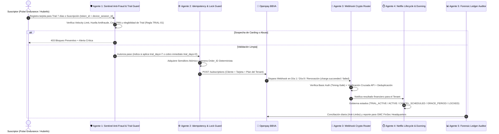
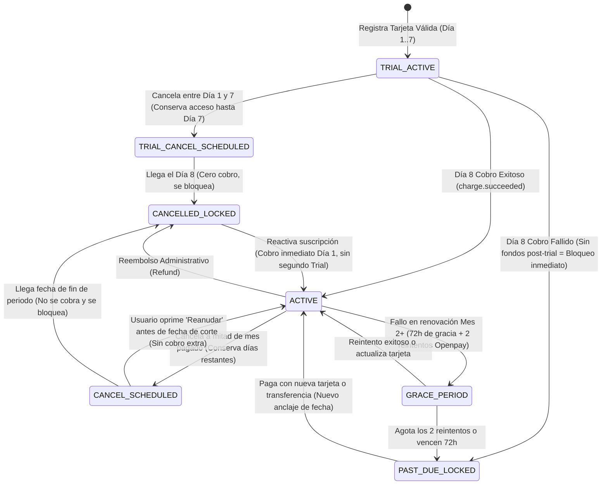

# ESCUADRÓN DE AGENTES DE MONITOREO Y SEGURIDAD FINANCIERA (FINSEC AGENTS)
## Arquitectura de Vigilancia Autónoma 24/7 para el GMC FinSec Billing Engine

**Propiedad de:** German Morales Consulting (`GM CONSULTING`)  
**Propósito:** Garantizar que cada periodo de prueba de 7 días, suscripción mensual, webhook, cancelación a mitad de ciclo, reactivación y reembolso en cualquiera de las aplicaciones conectadas (*Pulse Endurance*, *Hubinfo*, etc.) sea auditado, protegido contra fraude y conciliado en tiempo real.

---

## 1. Mapa de Orquestación de Agentes FinSec

Cinco agentes especializados operan en cadena (en tiempo real durante la transacción y en segundo plano mediante barridos programados):

---

## 2. Especificación Técnica de Cada Agente

### 🛡️ Agente 1: `Sentinel-AntiFraud` (Prevención de Fraude, Carding, Abuso de Trial y Fuga PCI)
* **Cuándo actúa:** Síncronamente en el milisegundo previo a cualquier llamada hacia Openpay (`pre-flight check`).
* **Amenazas que neutraliza:**
  1. **Abuso de los 7 Días Gratuitos (*Trial Hopping*):** Usuarios que crean y cancelan suscripciones repetidamente o usan la misma tarjeta en distintas cuentas para nunca pagar.
  2. **Ataques de *Carding* (Fuerza bruta con tarjetas robadas):** Uso de formularios para probar lotes de tarjetas robadas.
  3. **Fuga accidental de datos PCI:** Que un payload intente enviar los 16 dígitos de la tarjeta al servidor.
  4. **Omisión del motor antifraude de BBVA:** Peticiones sin `device_session_id` legítimo.
* **Reglas de Disparo y Bloqueo:**
  * **Regla `TRIAL-01` (Control Único de 7 Días Gratis):** Consulta el registro histórico `gmc_trial_registry` verificando el `subscriberId`, el `email` y la huella de la tarjeta (`BIN + últimos 4 dígitos + titular`). Si ya consumió los 7 días gratuitos en el pasado para ese `tenantId`, fuerza automáticamente `trial_days = 0` (cobro inmediato desde el Día 1).
  * **Regla `VEL-01` (Velocity por Suscriptor/IP):** Máximo **3 intentos de tarjeta** en una ventana móvil de **15 minutos**. Al 4to intento, bloquea temporalmente por 24 horas y marca alerta `CARDING_ATTEMPT_DETECTED`.
  * **Regla `PCI-01` (Sanitizador de Payload):** Escanea recursivamente el JSON entrante buscando patrones de 13 a 19 dígitos o llaves prohibidas (`card_number`, `cvv2`, `pan`). Si detecta coincidencia, destruye el payload en memoria, rechaza con `422 PCI_VIOLATION_ABORT` y nunca escribe en logs.
  * **Regla `DEV-01` (Huella Digital Obligatoria):** Exige que `device_session_id` tenga formato válido generado por `openpay-data.js`.

---

### ⚙️ Agente 2: `Idempotency-Lock-Guard` (Prevención Matemática de Doble Cobro)
* **Cuándo actúa:** Antes de ejecutar cualquier mutación financiera (`subscribe`, `resume`, `swap_card`, `cancel`, `refund`).
* **Mecanismo de Control:**
  1. **Semáforo Distribuido Atómico (`gmc_billing_locks`):** Crea un registro atómico con clave `{tenantId}:{subscriberId}:{operation}` y `TTL = 60 segundos`. Si entra una petición duplicada por doble clic o reintento de red, la rechaza con `409 Conflict`.
  2. **Generador de `order_id` Determinista:**
     $$\text{order\_id} = \text{GMC}-\{\text{TENANT}\}-\text{SUB}-\{\text{SUBSCRIBER\_ID}\}-\{\text{YYYYMM}\}$$

---

### 🔐 Agente 3: `Webhook-Crypto-Router` (Verificación Criptográfica y Enrutamiento Multi-App)
* **Cuándo actúa:** En cada notificación entrante al endpoint `/api/billing/openpay/webhook`.
* **Mecanismo de Control:**
  1. **Comparación Criptográfica en Tiempo Constante:** Verifica la cabecera `Authorization: Basic ...` utilizando `crypto.timingSafeEqual()`.
  2. **Verificación Cruzada en Caliente (*Double-Check Server-to-Server*):** Antes de activar un acceso por `charge.succeeded`, consulta directamente la API privada de Openpay (`GET /v1/{MERCHANT_ID}/charges/{transaction.id}`) para confirmar que el pago existe y está en estado `completed` en los servidores de BBVA.
  3. **Deduplicación en el Libro Mayor:** Verifica que `transaction.id` no haya sido procesado previamente en `gmc_immutable_ledger`.
  4. **Enrutamiento Multi-Tenant:** Extrae el `tenantId` (`PULSE_ENDURANCE`, `HUBINFO`, etc.) y dirige la actualización de estado a la aplicación correspondiente.

---

### ⏱️ Agente 4: `Netflix-Lifecycle-Dunning` (Máquina de Estados: Trial 7d, Renovación, Cancelación y Corte)
* **Cuándo actúa:** En cada validación de sesión del usuario y mediante barrido programado cada 6 horas.
* **Máquina de Estados Completa que Gobierna:**

---

### 📊 Agente 5: `Forensic-Ledger-Auditor` (Conciliación Bancaria BBVA y Alimentación de `GMC FinSec HQ`)
* **Cuándo actúa:** Diariamente a las 03:00 AM y bajo demanda en la consola ejecutiva.
* **Funciones Clave:**
  1. **Reparación Anti-Limbo:** Compara los cargos aprobados en Openpay de las últimas 48h contra `gmc_immutable_ledger`. Si un webhook se perdió por mantenimiento de red, asienta el pago y activa al usuario automáticamente.
  2. **Cálculo de Comisiones BBVA y Neto Semanal:**
     * Calcula por cada transacción de monto $M$:
       $$\text{Comisión Openpay BBVA} = (M \times 0.0299) + 800$$
       $$\text{IVA Comisión (19\%)} = \text{Comisión Openpay BBVA} \times 0.19$$
       $$\text{Neto a Recibir el Miércoles en BBVA} = M - (\text{Comisión} + \text{IVA})$$
  3. **Alimentación de `GMC FinSec Headquarters` (Fase 4):** Consolida métricas por `tenantId` (*Pulse Endurance*, *Hubinfo*, etc.) para mostrar ingresos brutos, comisiones, reembolsos y conversión de Trials de 7 días a suscriptores pagos.
