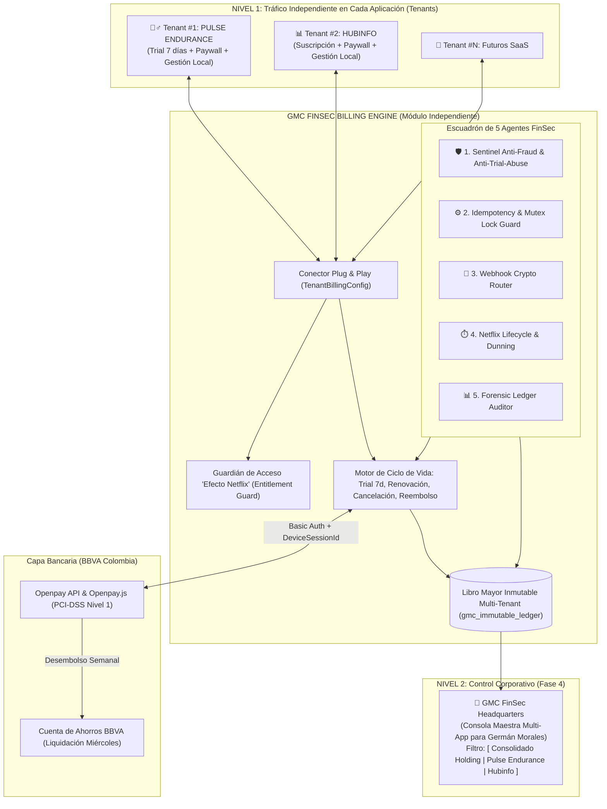
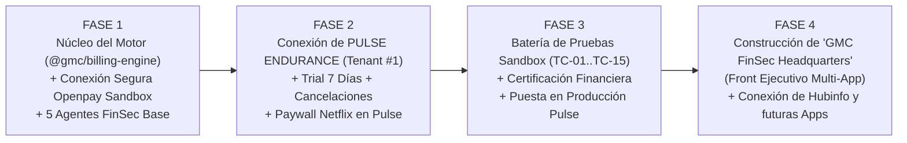

# GMC FINSEC BILLING ENGINE
## Motor Centralizado y Plug-and-Play de Suscripciones, Trial de 7 Días, Cobros Recurrentes y Seguridad Financiera
**Propiedad de:** German Morales Consulting (`GM CONSULTING`)  
**Pasarela Bancaria Base:** Openpay Colombia (Grupo BBVA) + Riel Local Manual (Bre-B / Transferencia)  
**Primer Proyecto Conectado (Tenant #1):** Pulse Endurance  
**Siguientes Proyectos (Tenant #2..N):** Hubinfo, Motor de Noticias y futuros SaaS  

---

## 1. Visión y Propósito del Módulo

El **GMC FinSec Billing Engine** es un módulo de software independiente, desacoplado y reutilizable (*Plug & Play*), diseñado para gestionar todo el ciclo de vida del dinero, pruebas gratuitas con tarjeta obligatoria (*7-Day Card-Upfront Trial*), suscripciones recurrentes (modelo **Netflix**), cancelaciones, reversiones y auditoría contable para **cualquier aplicación actual o futura** del portafolio de **German Morales Consulting**.

### Principios Innegociables de Ingeniería
1. **100% Agnóstico del Dominio:** El núcleo del motor **no conoce** conceptos específicos de ninguna aplicación. Opera exclusivamente con entidades financieras universales:
   * **`Tenant`:** La aplicación conectada (`PULSE_ENDURANCE`, `HUBINFO`, etc.).
   * **`Subscriber`:** El usuario o cuenta cliente que se suscribe.
   * **`Plan`:** La plantilla tarifaria, días de prueba (`trialDays: 7`) y periodicidad de cobro.
   * **`Entitlement`:** El derecho lógico/criptográfico que habilita o bloquea el uso de la aplicación.
   * **`LedgerEntry`:** Asiento contable inmutable de cada movimiento de dinero.
2. **Modelo "Hub & Spoke" (Tráfico Operativo por App + Consola Ejecutiva Unificada):**
   * **En cada Aplicación:** Cada proyecto (*Pulse Endurance*, *Hubinfo*) maneja su propio checkout, su propio Paywall y su propio tráfico interno sin que el usuario salga de su aplicación.
   * **Para la Cabeza de la Compañía (`GMC FinSec Headquarters`):** Todas las aplicaciones registran sus asientos en un Libro Mayor unificado (`gmc_immutable_ledger`) etiquetado por `tenantId`, permitiendo auditar ingresos, comisiones BBVA y reembolsos de todas las aplicaciones desde una sola Consola Ejecutiva Maestra.
3. **Seguridad Bancaria de Grado Militar (Zero-Trust FinSec):** Cero almacenamiento de datos de tarjetas (PCI-DSS SAQ-A), cero secretos hardcodeados en código o documentación, protección activa contra abuso de pruebas gratuitas (*Anti-Trial Hopping*) y contra ataques de *carding*, validación criptográfica en tiempo constante y bloqueo distribuido contra cobros dobles.

---

## 2. Arquitectura General Multi-App y Consola Ejecutiva (`GMC FinSec HQ`)



---

## 2.5. Separación Arquitectónica: ¿Qué vive en el Motor vs. Qué decide cada Aplicación (`TenantBillingConfig`)?

Para garantizar que el motor sea **100% Plug & Play** y sirva para cualquier modelo de negocio futuro sin tener reglas quemadas de *Pulse Endurance*, existe una separación estricta entre **La Capacidad Técnica (Motor)** y **La Política Comercial (Aplicación)**:

* ⚙️ **En el Motor de Pagos (`@gmc/billing-engine` + Openpay) vive el MECANISMO:**
  1. La capacidad de tokenizar una tarjeta hoy, validarla en `$0` y programar en Openpay un cobro diferido a `N` días (`trial_days: N`).
  2. El registro de huellas de tarjeta (`gmc_trial_registry`) para impedir que un usuario use la misma tarjeta para pedir pruebas gratis infinitas veces (*Anti-Trial Hopping*).
  3. El semáforo que vigila cuándo se cumplen esos `N` días para procesar el cobro del Día `N+1` o bloquear el acceso si falla.
* 🎯 **En cada Aplicación (*Pulse Endurance*, *Hubinfo*, etc.) vive la REGLA COMERCIAL (`trialDays`):**
  * El motor **no tiene quemado el número 7**. Cada aplicación le inyecta su propio contrato de configuración (`TenantBillingConfig`) diciéndole cuántos días de prueba ofrece:

```typescript
// Contrato Plug & Play que cada aplicación le pasa al Motor:
export interface TenantBillingConfig {
  tenantId: string;           // Ej: "PULSE_ENDURANCE" | "HUBINFO"
  displayName: string;
  plans: Array<{
    planCode: string;         // Ej: "PULSE_PRO_MONTHLY"
    amountCop: number;        // Ej: 99000
    interval: "MONTH" | "YEAR";
    trialDays: number;        // 👈 LA APP DECIDE: Pulse envía 7; otra app puede enviar 0 o 14
    dunningGraceHours: number;// 👈 LA APP DECIDE: Ej. 72 horas para reintentos en clientes antiguos
  }>;
}
```

| Aplicación Conectada (Tenant) | Valor que la App envía al Motor (`trialDays`) | ¿Cómo actúa el Motor de Pagos automáticamente? |
| :--- | :--- | :--- |
| **Pulse Endurance** (Plan Atleta) | `trialDays: 7` | Pide tarjeta en el Día 1, da **7 días gratis** y cobra en el Día 8. |
| **Pulse Endurance** (Promo Especial / Anual) | `trialDays: 0` (o `14`) | Cobra de inmediato el Día 1 (o da 14 días según el plan elegido). |
| **Hubinfo** (Otro SaaS del Holding) | `trialDays: 0` | Pide tarjeta y **cobra inmediatamente en el Día 1** (sin días gratis). |

---

## 3. Reglas Completas del Ciclo de Vida: Trial Parametrizable (Ej. 7 Días en Pulse), Cancelaciones, Renovaciones y Casos Borde

Esta sección define con precisión matemática cómo debe comportarse el sistema en **todos los escenarios posibles** para que ni el usuario ni la compañía tengan jamás un inconveniente:

### Escenario 1: Alta con 7 Días Gratuitos y Tarjeta Obligatoria (*7-Day Card-Upfront Trial*)
* **Requisito de Entrada:** Ningún usuario entra al periodo de prueba sin registrar primero una tarjeta válida en el formulario seguro (`Openpay.js` + `device_session_id`).
* **Día 1 (Registro):**
  * Se tokeniza la tarjeta, se valida contra el banco que esté activa y se crea la suscripción en Openpay con `trial_days: 7` (estado inicial: `TRIAL_ACTIVE`).
  * **No se cobra la mensualidad en el Día 1.**
  * Se establece `trialEndDate = Hoy + 7 días` y `currentPeriodEnd = Hoy + 7 días`.
  * El usuario recibe acceso inmediato a la aplicación y ve claramente: *"Estás en tus 7 días de prueba gratuita. Tu primer cobro por $X se realizará automáticamente el [Fecha Día 8] a menos que canceles antes"*.
* **Día 8 (Fin del Trial y Primer Cobro Automático):**
  * Openpay ejecuta automáticamente el primer cargo de la mensualidad.
  * **Si el cobro es APROBADO (`charge.succeeded`):** El estado pasa a `ACTIVE`, se marca `billingStatus = "PAID"`, y `currentPeriodEnd` se extiende por 1 mes completo (`Día 8 + 1 mes`).
  * **Si el cobro del Día 8 FALLA (`charge.failed` — tarjeta sin fondos):** A diferencia de clientes antiguos, **en el primer cobro post-trial NO hay días adicionales de gracia**. El usuario pasa inmediatamente a `PAST_DUE_LOCKED` (Paywall bloqueante) hasta que proporcione una tarjeta con fondos. *(Esto evita que usuarios malintencionados usen tarjetas virtuales vacías para obtener días gratis adicionales).*

### Escenario 2: Prevención de Abuso de los 7 Días Gratis (*Anti-Trial Hopping*)
* **El Problema:** ¿Qué pasa si un usuario usa sus 7 días gratis, cancela en el Día 6, y en el Día 8 intenta volver a suscribirse para obtener otros 7 días gratis?
* **La Solución del Motor (`gmc_trial_registry`):**
  * En el momento en que un usuario inicia su prueba gratuita por primera vez, el Agente `Sentinel-AntiFraud` registra de forma permanente:
    1. `hasConsumedTrial: true` en el perfil del `subscriberId` para ese `tenantId`.
    2. La huella de la tarjeta (`BIN + últimos 4 dígitos + nombre titular + email`) en la colección `gmc_trial_registry`.
  * Si ese usuario (o esa misma tarjeta) intenta suscribirse por segunda vez en el futuro, el motor detecta que ya consumió su beneficio y crea la suscripción con **`trial_days: 0` (Cobro inmediato en el Día 1)**, informándole en pantalla antes de pagar: *"Ya utilizaste tu periodo de prueba gratuito anteriormente. Tu suscripción se activará con cobro inmediato hoy"*.

### Escenario 3: Cancelación Durante los 7 Días de Prueba (Día 1 al Día 7)
* El usuario está en el Día 3 de sus 7 días gratuitos y hace clic en *"Cancelar mi suscripción"*.
* **Comportamiento Exacto:**
  1. El motor cancela inmediatamente la orden de cobro futuro en Openpay para garantizar al 100% que **en el Día 8 no se le hará ningún cargo**.
  2. El estado pasa a `TRIAL_CANCEL_SCHEDULED` (`cancelAtPeriodEnd = true`).
  3. **¿Cuándo se le corta el acceso?** Conserva el acceso durante los días restantes de su prueba hasta cumplirse el Día 7 (`trialEndDate`). En pantalla ve: *"Suscripción cancelada. No se realizará ningún cobro a tu tarjeta. Puedes seguir usando tus días de prueba restantes hasta el [Fecha Día 7]"*.
  4. Al cumplirse el Día 7, el acceso se bloquea automáticamente (`CANCELLED_LOCKED`).

### Escenario 4: Cancelación a Mitad de un Mes Ya Pagado (Ej. Día 18 de 30)
* El usuario ya pagó su mes (por ejemplo, su periodo pagado va del **10 de Octubre al 10 de Noviembre**). El **22 de Octubre** decide cancelar porque no quiere continuar el próximo mes.
* **Comportamiento Exacto (Estándar Netflix):**
  1. **Cero cobros futuros:** El motor instruye a Openpay la baja de la renovación automática y marca `cancelAtPeriodEnd = true`, `status = "CANCEL_SCHEDULED"`.
  2. **Respeto total por el tiempo ya pagado:** **NO se le bloquea la aplicación el 22 de Octubre.** El usuario ya pagó hasta el 10 de Noviembre, por lo que sigue teniendo acceso completo durante los 19 días restantes.
  3. **Transparencia en la Interfaz:** En su perfil y barra de estado aparece:
     > *"Tu suscripción ha sido cancelada y no se renovará. Seguirás teniendo acceso total hasta el **10 de Noviembre de 2026**. Después de esa fecha no se realizará ningún cobro y tu cuenta quedará inactiva."*
  4. **Corte exacto al vencimiento:** El **10 de Noviembre a las 23:59:59**, el Agente `Netflix-Lifecycle` cambia su estado a `CANCELLED_LOCKED` y despliega el Paywall.

### Escenario 5: "Arrepentimiento de Cancelación" (Reanudar antes de que venza el mes pagado)
* Siguiendo el ejemplo anterior: el usuario canceló el 22 de Octubre (con acceso vigente hasta el 10 de Noviembre), pero el 28 de Octubre cambia de opinión y quiere mantener su suscripción activa.
* **Comportamiento Exacto:**
  * Mientras hoy sea menor al 10 de Noviembre (`now < currentPeriodEnd`), en su perfil ve el botón `[ Reanudar mi Suscripción ]`.
  * Si lo oprime el 28 de Octubre, **NO se le cobra de nuevo ese día** (porque su mes hasta el 10 de Noviembre ya está pagado); simplemente el motor restaura la renovación automática en Openpay para que el próximo cobro ocurra normalmente el 10 de Noviembre, volviendo su estado a `ACTIVE`.

### Escenario 6: Reactivación Después de que el Plan ya Venció y Está Bloqueado
* El usuario canceló, llegó el 10 de Noviembre y su cuenta quedó bloqueada (`CANCELLED_LOCKED`). El **25 de Noviembre** regresa y quiere volver a usar la aplicación.
* **Comportamiento Exacto:**
  * Al entrar ve el Paywall de reactivación.
  * Como ya usó su prueba gratis en el pasado (`hasConsumedTrial === true`), **se le cobra inmediatamente el 25 de Noviembre**.
  * Su cuenta se desbloquea en ese segundo y su **nueva fecha de corte mensual se re-ancla al día 25 de cada mes** (25 de Noviembre al 25 de Diciembre), para que nunca pague por los 15 días que estuvo inactivo.

### Escenario 7: Fallo de Tarjeta en Renovación de un Suscriptor Antiguo (Mes 2+ — Dunning)
* Un usuario que ya lleva meses pagando puntualmente sufre un rechazo bancario el día de su renovación mensual (ej. tarjeta bloqueada temporalmente o falta de cupo en quincena).
* **Comportamiento Exacto:**
  1. Pasa a estado `GRACE_PERIOD` por **72 horas** mientras Openpay ejecuta hasta **2 reintentos automáticos**.
  2. El usuario no pierde su entrenamiento ese primer día, pero ve un banner de alerta prioritaria: *"⚠️ No pudimos procesar la renovación de tu suscripción. Reintentaremos automáticamente o actualiza tu tarjeta aquí para evitar el bloqueo de tu cuenta el [Fecha + 72h]"*.
  3. Si en los reintentos el pago pasa $\rightarrow$ vuelve a `ACTIVE` de forma transparente.
  4. Si tras las 72h y los reintentos el pago sigue rechazado $\rightarrow$ pasa a `PAST_DUE_LOCKED` y se bloquea la aplicación.

### Escenario 8: Cambio de Tarjeta a Mitad de Ciclo (*Card Swap*)
* El usuario tiene su suscripción activa pero quiere cambiar la tarjeta registrada (porque se le venció el plástico o prefiere usar otra).
* **Comportamiento Exacto:**
  * Abre `<GmcCardCheckoutModal mode="update_card" />`, tokeniza la nueva tarjeta con `Openpay.js`, el motor asocia la nueva tarjeta a la suscripción activa en Openpay y elimina la anterior **sin generar ningún cobro adicional ese día**. El siguiente cobro en su fecha de corte normal se hará sobre la nueva tarjeta.

### Escenario 9: Reembolso Administrativo (`Refund`) o Contracargo (`Chargeback`)
* **Reembolso por el Administrador:** Si desde la consola apruebas devolver el dinero de un mes (por ejemplo, por lesión comprobada o cobro por error), el motor llama a la API de reembolsos de Openpay, devuelve el dinero a la tarjeta y **corta el acceso en ese mismo segundo (`CANCELLED_LOCKED`)** para que la fecha de vigencia refleje la devolución.
* **Contracargo Bancario (`chargeback.created`):** Si un usuario desconoce maliciosamente un cargo ante su banco, el Agente `Sentinel` congela instantáneamente la cuenta en estado `SUSPENDED_FRAUD` y recopila las pruebas de uso (`device_session_id`, IP, logs de sesiones) para defender el dinero ante BBVA.

---

## 4. Plan de Ejecución Faseado (Paso a Paso Gradual sin Sobrecarga)

Para garantizar una implementación limpia, segura y libre de errores, **no construiremos todo de golpe**. Avanzaremos en **4 Fases secuenciales**, validando que cada etapa funcione al 100% antes de pasar a la siguiente:



### 🔹 FASE 1: Construcción del Núcleo Independiente y Conexión Bancaria (`gmc-billing-engine`)
* **Objetivo:** Tener el motor financiero aislado, configurado con las llaves de Sandbox de Openpay BBVA en `.env.local` (cero hardcoding) y con los contratos listos.
* **Entregables:**
  1. `gmc-billing-engine/src/core/` (Configuración Zod, Tipos Multi-Tenant, Semáforo de Idempotencia y Guardián de Estados `entitlementGuard`).
  2. `gmc-billing-engine/src/providers/openpay/` (Cliente HTTP con Basic Auth, creación de Planes con `trial_days: 7`, Clientes, Tarjetas, Suscripciones, Cancelaciones y Reembolsos).
  3. `gmc-billing-engine/src/agents/` (Los 5 Agentes FinSec operativos en código).
  4. Endpoint de Webhook blindado y verificado contra el panel Sandbox de Openpay.

### 🔹 FASE 2: Integración Plug & Play en el Primer Proyecto (`PULSE ENDURANCE`)
* **Objetivo:** Que **Pulse Endurance** opere de punta a punta con el modelo Netflix, Trial de 7 días y riel dual (Openpay Tarjeta + Bre-B Manual).
* **Entregables:**
  1. Inyección de la configuración `TENANT_PULSE_ENDURANCE` en Pulse.
  2. Modal seguro de registro de tarjeta `<GmcCardCheckoutModal />` con `Openpay.js` y `device_session_id` para iniciar los 7 días de prueba gratis.
  3. Pantalla de bloqueo `<GmcPaywallLockView />` conectada al enrutador principal de Pulse para bloquear automáticamente a quien tenga el periodo vencido.
  4. Panel de autogestión en el perfil del atleta para ver qué día termina su prueba o mes, cambiar tarjeta o cancelar su suscripción con 1 clic (respetando los días ya pagados).
  5. Botón de Reembolso y control de estados en el Admin Panel actual de Pulse.

### 🔹 FASE 3: Certificación de Seguridad y Pruebas en Sandbox (Pre-Producción)
* **Objetivo:** Someter la integración de Pulse Endurance a las pruebas de fuego con las tarjetas de prueba de Openpay.
* **Entregables:**
  1. Ejecución verificada de la matriz de pruebas: Alta de 7 días de prueba, bloqueo de intento de doble trial (*Anti-Trial Hopping*), cancelación en día de prueba, cancelación a mitad de mes pagado, rechazo de tarjeta sin fondos, doble clic concurrente y reembolso.
  2. Certificación lista para pasar las llaves de Openpay BBVA a modo Producción.

### 🔹 FASE 4: Construcción del Front Ejecutivo `GMC FinSec Headquarters` y Expansión Multi-App
* **Objetivo:** Una vez Pulse Endurance esté facturando y estable, construir la consola maestra para **Germán Morales** como cabeza de **German Morales Consulting**.
* **Entregables:**
  1. Interfaz ejecutiva `<GmcHoldingFinanceConsole />` con selector multi-aplicación (`[ Consolidado | Pulse Endurance | Hubinfo | ... ]`).
  2. Conciliador visual de los desembolsos semanales de los miércoles en BBVA (Ingreso Bruto vs. Comisión Openpay 2.99% + $800 + IVA vs. Neto en Cuenta).
  3. Buscador global de transacciones y monitor en vivo del Escuadrón de 5 Agentes FinSec.
  4. Conexión Plug & Play de la segunda aplicación (*Hubinfo*).

---

## 5. Documentación Complementaria del Motor

* 🤖 **[Especificación del Escuadrón de Agentes FinSec (`AGENTS_FINSEC_MONITORING.md`)](./AGENTS_FINSEC_MONITORING.md)**
* 🛡️ **[Políticas de Seguridad Bancaria y Matriz de 15 Pruebas (`SECURITY_AND_TEST_MATRIX.md`)](./SECURITY_AND_TEST_MATRIX.md)**
